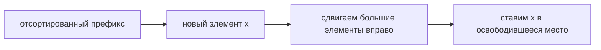
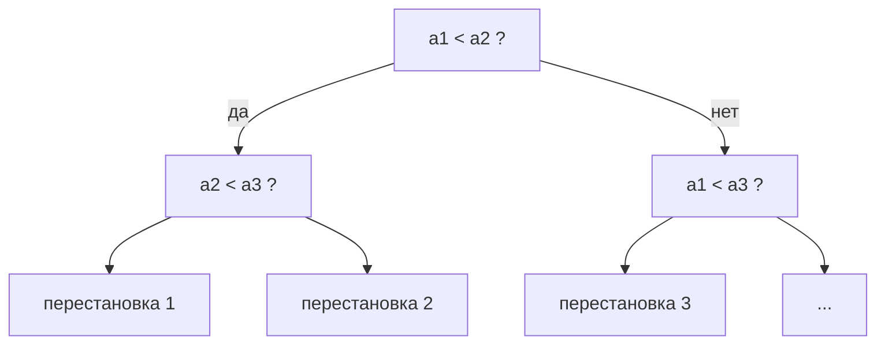
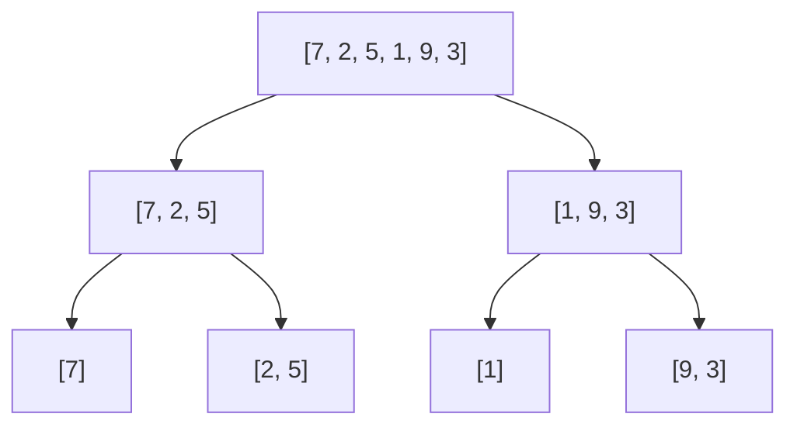
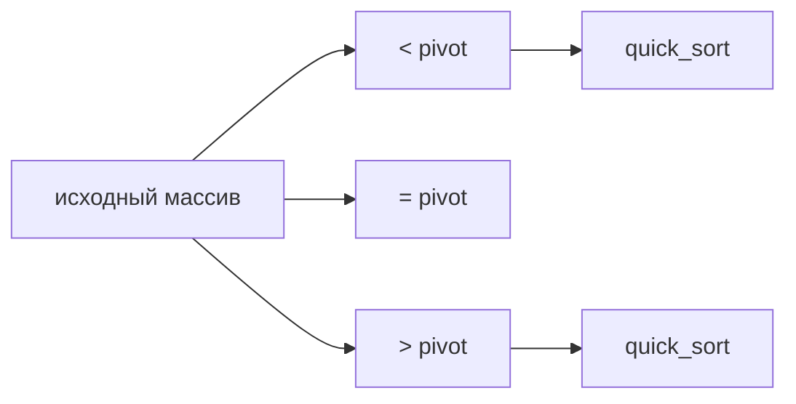
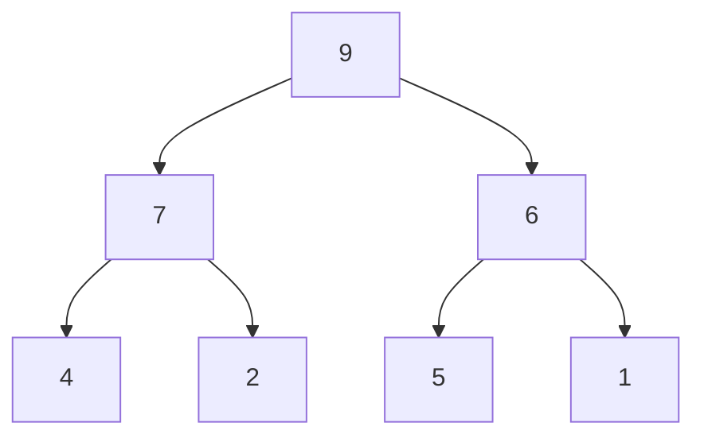
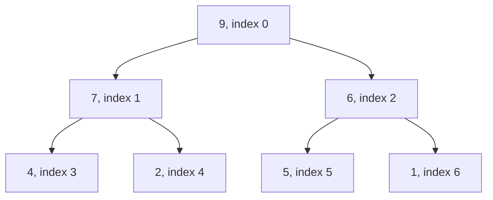
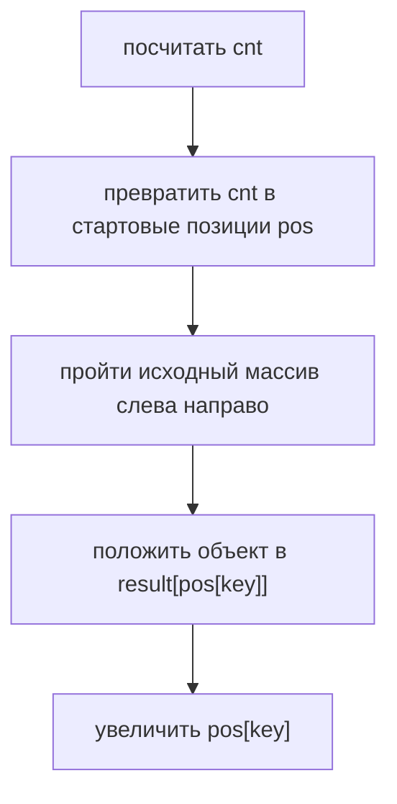
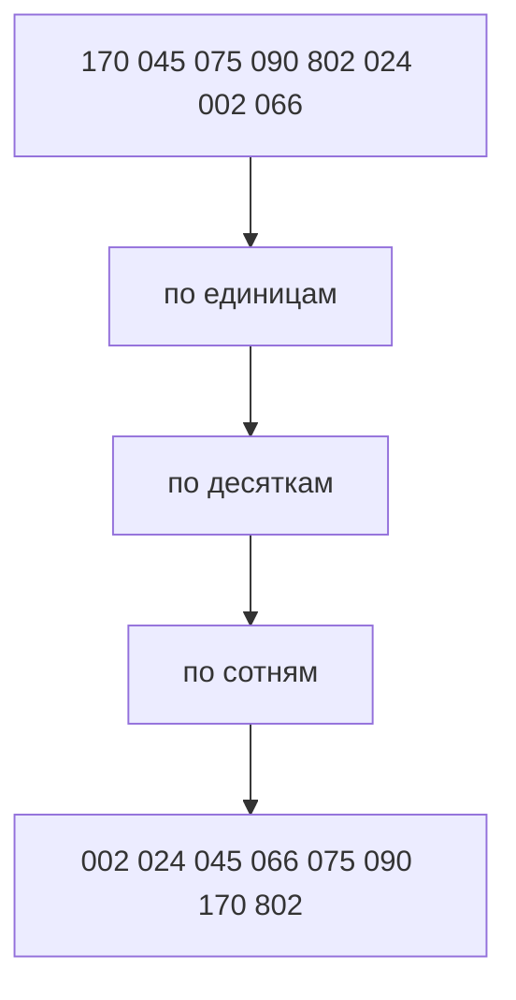
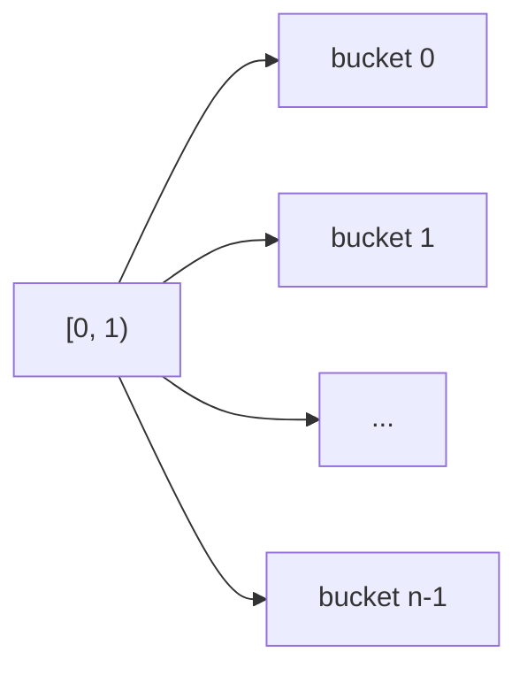
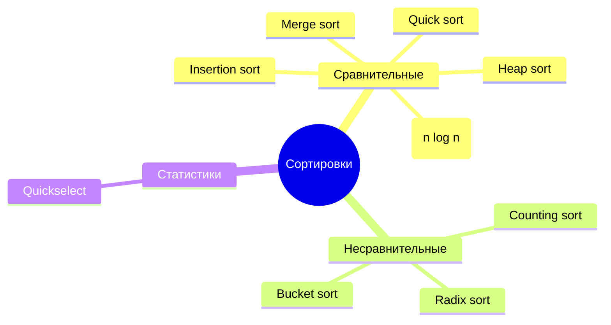

# Глава 7. Сортировки и порядковые статистики

## 7.1 Что вообще делает сортировка

Сортировка получает массив элементов и переставляет их так, чтобы ключи шли в неубывающем порядке:

$$
a_0 \le a_1 \le \dots \le a_{n-1}
$$

Важно различать **элемент** и **ключ**. Иногда элемент — это просто число. Но часто элемент — структура:

```cpp
struct Student {
    string name;
    int group;
    int score;
};
```

Тогда можно сортировать студентов по `score`, по `group`, по паре `(group, score)` и так далее. Алгоритм работает не с объектом целиком, а с выбранным ключом.

## 7.2 Какие свойства сортировок сравнивают

| Свойство | Что значит |
|---|---|
| Время | сколько элементарных операций делает алгоритм |
| Память | сколько дополнительной памяти нужно |
| Устойчивость | сохраняется ли порядок равных ключей |
| In-place | работает ли почти без дополнительной памяти |
| Сравнительность | использует ли только операции сравнения |

**Устойчивая сортировка** особенно важна для сортировки объектов.

Пример:

```text
(A, 5), (B, 3), (C, 5)
```

Если сортируем по числу, то после устойчивой сортировки элементы с ключом `5` останутся в исходном порядке:

```text
(B, 3), (A, 5), (C, 5)
```

А не так:

```text
(B, 3), (C, 5), (A, 5)
```

## 7.3 Элементарные операции и асимптотика

Когда говорим, что алгоритм работает за `O(f(n))`, мы оцениваем число элементарных действий при росте размера входа.

Элементарные действия:

- сравнить два числа;
- сложить два числа;
- обратиться к элементу массива;
- присвоить значение переменной;
- перейти по указателю.

> [!warning]
> Сравнение двух строк не всегда `O(1)`. В худшем случае нужно сравнить все символы, поэтому сравнение строк длины `m` стоит `O(m)`.

Обозначения:

| Запись    | Смысл                                                       |
| --------- | ----------------------------------------------------------- |
| `O(f(n))` | верхняя оценка: алгоритм не хуже некоторой константы `f(n)` |
| `Ω(f(n))` | нижняя оценка: быстрее этой функции в данной модели нельзя  |
| `Θ(f(n))` | точная асимптотика: и сверху, и снизу                       |

## 7.4 Простые квадратичные сортировки

Они обычно не являются целью курса, но нужны как база.

### Bubble sort

Идея: много раз пройти по массиву и менять соседние элементы, если они стоят в неправильном порядке.

```text
bubble_sort(a):
    for pass = 0..n-1:
        for i = 0..n-2:
            if a[i] > a[i+1]:
                swap(a[i], a[i+1])
```

После первого полного прохода максимум "всплывает" в конец.

Сложность: `O(n^2)`.

Плюсы почти отсутствуют, кроме простоты. На практике использовать не надо.

### Insertion sort

Идея: поддерживаем отсортированный префикс и вставляем следующий элемент на правильное место.

```text
insertion_sort(a):
    for i = 1..n-1:
        x = a[i]
        j = i - 1
        while j >= 0 and a[j] > x:
            a[j+1] = a[j]
            j--
        a[j+1] = x
```



Сложность:

- худший случай: `O(n^2)`;
- почти отсортированный массив: близко к `O(n)`;
- память: `O(1)`;
- устойчивость: да.

Insertion sort часто используют внутри более сложных сортировок на маленьких подмассивах.

### Selection sort

Идея: на каждой позиции найти минимум в оставшемся хвосте.

```text
selection_sort(a):
    for i = 0..n-1:
        best = i
        for j = i+1..n-1:
            if a[j] < a[best]:
                best = j
        swap(a[i], a[best])
```

Сложность всегда `O(n^2)`, даже если массив уже отсортирован.

## 7.5 Нижняя оценка для сортировок сравнениями

Если сортировка использует только сравнения вида `a[i] < a[j]`, её можно представить как дерево решений.

Каждая внутренняя вершина — сравнение. Каждое ребро — ответ "да" или "нет". Каждый лист — финальная перестановка.



Для `n` различных элементов существует `n!` возможных порядков. Корректная сортировка должна уметь прийти хотя бы к каждому из них. Значит, в дереве должно быть не меньше `n!` листьев.

Если высота дерева `h`, то листьев не больше `2^h`. Поэтому:

$$
2^h \ge n!
$$

Логарифмируем:

$$
h \ge \log_2(n!)
$$

По формуле Стирлинга:

$$
\log_2(n!) = \Theta(n \log n)
$$

Итак:

> [!important]
> Любая сортировка, основанная только на сравнениях, в худшем случае требует `Ω(n log n)` сравнений.

Это объясняет, почему merge sort, heap sort и quick sort в хорошем варианте упираются примерно в `n log n`.

## 7.6 Merge sort

Merge sort — классический пример "разделяй и властвуй".

Идея:

1. Разделить массив пополам.
2. Рекурсивно отсортировать обе половины.
3. Слить две отсортированные половины.



### Слияние двух массивов

Пусть есть:

```text
left  = [2, 5, 7]
right = [1, 3, 9]
```

Держим два указателя `i` и `j`. Каждый раз берём меньший из `left[i]` и `right[j]`.

```text
merge(left, right):
    i = 0
    j = 0
    result = []

    while i < len(left) and j < len(right):
        if left[i] <= right[j]:
            result.push(left[i])
            i++
        else:
            result.push(right[j])
            j++

    append remaining left[i..]
    append remaining right[j..]
    return result
```

Обрати внимание на `<=`: если ключи равны, первым берём элемент из левой половины. Так merge sort остаётся устойчивым.

### Сложность

На каждом уровне рекурсии суммарно сливается `n` элементов. Уровней `log n`.

$$
T(n) = 2T(n/2) + O(n) = O(n \log n)
$$

Память: `O(n)` на дополнительный массив.

## 7.7 Quick sort

Quick sort тоже делит массив, но не гарантирует равные половины.

Идея:

1. Выбрать опорный элемент `pivot`.
2. Разбить массив на элементы `< pivot`, `= pivot`, `> pivot`.
3. Рекурсивно отсортировать левую и правую части.



### Трёхпутевое разбиение

Оно полезно, когда в массиве много равных элементов.

```text
partition3(a, l, r):
    pivot = a[random(l, r)]
    lt = l
    i = l
    gt = r

    while i <= gt:
        if a[i] < pivot:
            swap(a[lt], a[i])
            lt++; i++
        else if a[i] > pivot:
            swap(a[i], a[gt])
            gt--
        else:
            i++

    return (lt, gt)
```

После разбиения:

```text
a[l..lt-1]  < pivot
a[lt..gt]   = pivot
a[gt+1..r]  > pivot
```

### Сложность

| Случай | Что происходит | Время |
|---|---|---|
| Хороший pivot | части примерно `n/2` и `n/2` | `O(n log n)` |
| Плохой pivot | части `0` и `n-1` | `O(n^2)` |
| Случайный pivot | плохие разбиения редки | `O(n log n)` в среднем |

Quick sort обычно быстрый на практике: он хорошо работает с кэшем и требует мало дополнительной памяти. Но если pivot выбирать плохо, например всегда первый элемент на уже отсортированном массиве, можно получить квадрат.

Вот аккуратная версия конспекта под Obsidian: можно сразу вставлять в заметку.

## 7.8 Heap sort

**Heap sort** — это алгоритм сортировки, который использует структуру данных **двоичная куча**.

Чаще всего для сортировки по возрастанию используют **max-heap**.

---

## Идея max-heap

**Max-heap** — это двоичная куча, в которой каждый родительский элемент не меньше своих детей.

То есть для каждой вершины выполняется условие:

$$  
parent \ge leftChild  
$$

$$  
parent \ge rightChild  
$$

Пример max-heap:



Здесь самый большой элемент находится в корне дерева.

В данном примере:

$$  
max = 9  
$$

---

## Представление кучи в массиве

Двоичную кучу обычно хранят не как дерево, а как обычный массив.

Для вершины с индексом `v`:

```text
left = 2 * v + 1
right = 2 * v + 2
parent = (v - 1) // 2
```

Например, массив:

```text
[9, 7, 6, 4, 2, 5, 1]
```

соответствует куче:



---

## Основная идея Heap sort

Heap sort работает так:

1. Из массива строится **max-heap**.
    
2. Самый большой элемент оказывается в корне, то есть в `a[0]`.
    
3. Корень меняется местами с последним элементом текущей кучи.
    
4. Последний элемент теперь стоит на своём правильном месте.
    
5. Размер кучи уменьшается на `1`.
    
6. Новый корень просеивается вниз, чтобы восстановить свойство max-heap.
    
7. Процесс повторяется, пока куча не станет пустой.
    

---

## Почему это сортирует массив?

В max-heap самый большой элемент всегда находится в корне.

Значит, если каждый раз брать корень и переносить его в конец массива, то в конец будут последовательно вставать элементы:

```text
самый большой,
второй по величине,
третий по величине,
...
```

В результате массив становится отсортированным по возрастанию.

---

## Псевдокод Heap sort

```text
heap_sort(a):
    build_max_heap(a)
    heap_size = n

    while heap_size > 1:
        swap(a[0], a[heap_size - 1])
        heap_size = heap_size - 1
        sift_down(0, heap_size)
```

Где:

- `a[0]` — корень кучи;
    
- `heap_size` — текущий размер кучи;
    
- элементы после `heap_size` уже отсортированы;
    
- `sift_down` восстанавливает свойство max-heap.
    

---

## Просеивание вниз

После обмена корня с последним элементом на место корня может попасть маленький элемент.

Из-за этого свойство max-heap может нарушиться.

Чтобы его восстановить, используется операция **sift down** — просеивание вниз.

Идея:

1. Смотрим на текущую вершину.
    
2. Сравниваем её с левым и правым ребёнком.
    
3. Если один из детей больше текущей вершины, меняем текущую вершину с наибольшим ребёнком.
    
4. Повторяем, пока вершина не окажется на правильном месте.
    

---

## Псевдокод sift_down

```text
sift_down(v, heap_size):
    while true:
        left = 2 * v + 1
        right = 2 * v + 2
        largest = v

        if left < heap_size and a[left] > a[largest]:
            largest = left

        if right < heap_size and a[right] > a[largest]:
            largest = right

        if largest == v:
            break

        swap(a[v], a[largest])
        v = largest
```

---

## Пример работы

Пусть есть массив:

```text
[4, 7, 1, 9, 2, 6, 5]
```

Сначала строим max-heap:

```text
[9, 7, 6, 4, 2, 1, 5]
```

Теперь максимальный элемент `9` находится в корне.

Меняем корень с последним элементом:

```text
[5, 7, 6, 4, 2, 1, 9]
```

Элемент `9` уже стоит на своём месте.

Уменьшаем размер кучи:

```text
heap_size = 6
```

Теперь кучей считается только эта часть:

```text
[5, 7, 6, 4, 2, 1]
```

А эта часть уже отсортирована:

```text
[9]
```

После `sift_down` снова получаем max-heap:

```text
[7, 5, 6, 4, 2, 1, 9]
```

Дальше процесс повторяется.

---

## Сложность Heap sort

### Построение кучи

Построение max-heap занимает:

```text
O(n)
```

Хотя кажется, что должно быть `O(n log n)`, на самом деле большинство вершин находятся близко к листьям и просеиваются недалеко вниз.

Поэтому суммарно построение кучи работает за:

$$  
O(n)  
$$

---

### Удаление максимума

Каждое удаление максимума состоит из:

1. обмена корня с последним элементом;
    
2. уменьшения размера кучи;
    
3. просеивания вниз.
    

Просеивание вниз идёт по высоте дерева.

Высота двоичной кучи:

$$  
O(\log n)  
$$

Значит, одно удаление максимума занимает:

$$  
O(\log n)  
$$

Всего таких удалений `n`.

Итого:

$$  
O(n \log n)  
$$

---

## Итоговая сложность

|Операция|Сложность|
|---|--:|
|Построение max-heap|`O(n)`|
|Одно удаление максимума|`O(log n)`|
|Все удаления максимума|`O(n log n)`|
|Общая сложность|`O(n log n)`|
|Дополнительная память|`O(1)`|
|Устойчивость|Нет|

---

## Устойчивость

Heap sort **не является устойчивой сортировкой**.

Это значит, что равные элементы могут поменяться местами относительно друг друга.

Например, если есть два элемента с одинаковым ключом:

```text
5a, 5b
```

то после сортировки они могут оказаться в порядке:

```text
5b, 5a
```

---

## Главное

Heap sort:

- строит из массива max-heap;
    
- каждый раз достаёт максимум;
    
- переносит максимум в конец массива;
    
- восстанавливает кучу через `sift_down`;
    
- работает за `O(n log n)`;
    
- использует `O(1)` дополнительной памяти;
    
- не является устойчивой сортировкой.
    

Коротко:

```text
Heap sort = построить max-heap + n раз достать максимум
```
## 7.9 Counting sort

Counting sort нарушает нижнюю оценку `Ω(n log n)`, потому что не сравнивает элементы. Он использует значения ключей как индексы массива.

Пусть все числа целые и лежат в диапазоне `[0..k]`.

Пример:

```text
a = [2, 5, 4, 0, 6, 8, 6, 9, 8, 2, 0, 1]
```

Считаем частоты:

| value | 0 | 1 | 2 | 3 | 4 | 5 | 6 | 7 | 8 | 9 |
|---|---:|---:|---:|---:|---:|---:|---:|---:|---:|---:|
| count | 2 | 1 | 2 | 0 | 1 | 1 | 2 | 0 | 2 | 1 |

Потом выписываем каждое число столько раз, сколько оно встретилось:

```text
0, 0, 1, 2, 2, 4, 5, 6, 6, 8, 8, 9
```

Псевдокод для чисел:

```text
counting_sort_numbers(a, k):
    cnt[0..k] = 0

    for x in a:
        cnt[x]++

    pos = 0
    for value = 0..k:
        repeat cnt[value] times:
            a[pos] = value
            pos++
```

Сложность:

$$
O(n + k)
$$

Память:

$$
O(k)
$$

Если нужен отдельный результат, то память `O(n+k)`.

### Что делать с отрицательными числами

Если ключи лежат в `[minValue..maxValue]`, делаем сдвиг.

```text
index(x) = x - minValue
```

Например:

```text
a = [3, -1, 2, -4, 5]
minValue = -4
maxValue = 5
range = 10
```

Число `-4` попадает в индекс `0`, число `-1` — в индекс `3`, число `5` — в индекс `9`.

```text
counting_sort_with_shift(a):
    mn = min(a)
    mx = max(a)
    cnt[0..mx-mn] = 0

    for x in a:
        cnt[x - mn]++

    pos = 0
    for i = 0..mx-mn:
        repeat cnt[i] times:
            a[pos] = i + mn
            pos++
```

### Когда counting sort хорош

Он хорош, когда диапазон ключей сравним с числом элементов:

$$
k = O(n)
$$

Тогда:

$$
O(n+k)=O(n)
$$

Если элементов `100`, а ключи лежат от `0` до `10^{18}`, counting sort бессмысленен: массив частот невозможно хранить.

## 7.10 Устойчивый counting sort для объектов

Обычный вариант "выписать числа по частотам" сортирует только сами числа. Если элементы — объекты, нужно сохранить объект целиком.

Пусть есть записи:

```text
(A, key=2), (B, key=1), (C, key=2), (D, key=0)
```

Хотим получить:

```text
(D, key=0), (B, key=1), (A, key=2), (C, key=2)
```

Для этого считаем не только частоты, но и позиции.

### Префиксные суммы

Пусть:

```text
cnt[x] = сколько элементов с ключом x
```

Тогда:

```text
pos[x] = первая позиция в ответе, куда должен попасть ключ x
```

Пример:

| key | 0 | 1 | 2 |
|---|---:|---:|---:|
| cnt | 1 | 1 | 2 |
| pos | 0 | 1 | 2 |

Псевдокод:

```text
stable_counting_sort(a, k):
    cnt[0..k] = 0
    for obj in a:
        cnt[key(obj)]++

    pos[0] = 0
    for x = 1..k:
        pos[x] = pos[x-1] + cnt[x-1]

    result[0..n-1]
    for obj in a:
        x = key(obj)
        result[pos[x]] = obj
        pos[x]++

    return result
```

Почему сортировка устойчива: мы идём по исходному массиву слева направо, и для равных ключей каждый следующий объект кладётся правее предыдущего.



## 7.11 Radix sort

Radix sort сортирует ключи по разрядам. Он особенно полезен для целых чисел, строк фиксированной длины и объектов с составным ключом.

Есть два основных направления:

| Вариант | Порядок разрядов | Особенность |
|---|---|---|
| LSD | от младшего разряда к старшему | требует устойчивой сортировки на каждом шаге |
| MSD | от старшего разряда к младшему | рекурсивно делит на блоки |

### LSD radix sort

Пример чисел:

```text
170, 045, 075, 090, 802, 024, 002, 066
```

Сначала сортируем по единицам, потом по десяткам, потом по сотням.



На каждом разряде используем **устойчивый** counting sort.

```text
radix_sort_lsd(a, base, digits):
    for d = 0..digits-1:
        stable_counting_sort_by_digit(a, d, base)
```

Если `digits = d`, основание системы `base = b`, то:

$$
O(d(n+b))
$$

Для 32-битных чисел можно брать байты как разряды: `base = 256`, `digits = 4`. Тогда это фактически линейное время по `n`.

### Почему нужна устойчивость

После сортировки по младшему разряду порядок внутри одинакового старшего разряда должен сохранять уже полученную информацию.

Пример:

```text
21, 11, 12
```

После сортировки по единицам:

```text
21, 11, 12
```

После устойчивой сортировки по десяткам:

```text
11, 12, 21
```

Если второй шаг неустойчивый, `11` и `12` могут поменяться местами, и результат сломается.

### MSD radix sort

MSD идёт от старших разрядов к младшим:

1. разбить элементы по старшему разряду;
2. рекурсивно отсортировать каждый блок по следующему разряду;
3. остановиться, когда блок размера `0/1` или разряды закончились.

```text
radix_sort_msd(a, digit):
    if len(a) <= 1 or digit < 0:
        return

    split a into buckets by digit
    for bucket in buckets:
        radix_sort_msd(bucket, digit - 1)
    concatenate buckets
```

MSD удобен для строк разной длины и словарных задач.

## 7.12 Bucket sort

Bucket sort, или карманная сортировка, работает при предположении о распределении данных.

Классический случай: `n` вещественных чисел равномерно распределены на `[0, 1)`.

Идея:

1. создать `n` бакетов;
2. число `x` положить в бакет `floor(n*x)`;
3. отсортировать каждый бакет простой сортировкой;
4. склеить бакеты.



Псевдокод:

```text
bucket_sort(a):
    buckets[0..n-1] = empty lists

    for x in a:
        id = floor(n * x)
        buckets[id].push(x)

    for bucket in buckets:
        insertion_sort(bucket)

    concatenate buckets into a
```

Если данные равномерны, в каждом бакете ожидаемо `O(1)` элементов, поэтому суммарное время `O(n)`.

Если все элементы попадут в один бакет, получим сложность внутренней сортировки, например `O(n^2)`.

> [!warning]
> Bucket sort линейный не всегда, а только при хорошем распределении и удачном выборе бакетов.

## 7.13 Порядковые статистики

`k`-я порядковая статистика — элемент, который оказался бы на позиции `k` после сортировки.

Примеры:

- `k = 0` — минимум;
- `k = n-1` — максимум;
- `k = n/2` — медиана.

Можно отсортировать массив за `O(n log n)` и взять `a[k]`, но это избыточно.

## 7.14 Quickselect

Quickselect похож на quick sort, но рекурсивно идёт только в одну часть.

```text
quickselect(a, k):
    pivot = random element
    split a into L, E, G

    if k < len(L):
        return quickselect(L, k)
    if k < len(L) + len(E):
        return pivot
    return quickselect(G, k - len(L) - len(E))
```

Ожидаемая сложность:

$$
O(n)
$$

Почему: на каждом шаге мы тратим `O(n)` на разбиение, но продолжаем только в одной части.

Худший случай остаётся `O(n^2)`, если pivot постоянно плохой.

## 7.15 Как выбирать сортировку

| Условия | Хороший выбор |
|---|---|
| Нужна гарантированная сравнительная сортировка | merge sort или heap sort |
| Нужна быстрая практическая сортировка | randomized quick sort / introsort |
| Нужна устойчивость | merge sort или stable counting sort |
| Ключи целые и диапазон мал | counting sort |
| Целые фиксированной длины | radix sort |
| Вещественные равномерно на `[0,1)` | bucket sort |
| Нужно найти k-й элемент | quickselect |

## 7.16 Частые ошибки

- Думать, что `Ω(n log n)` запрещает все линейные сортировки. Оно запрещает только линейные **сравнительные** сортировки.
- Использовать counting sort при огромном диапазоне ключей.
- Забывать сдвиг для отрицательных чисел.
- Делать radix sort на неустойчивой сортировке по разряду.
- Считать bucket sort линейным без предположения о распределении.
- Выбирать quick sort с первым элементом как pivot на уже отсортированном массиве.
- Путать `O(n+k)` и `O(n)`: counting sort линейный только когда `k = O(n)`.
- Не учитывать стоимость сравнения строк.

## 7.17 Мини-конспект



