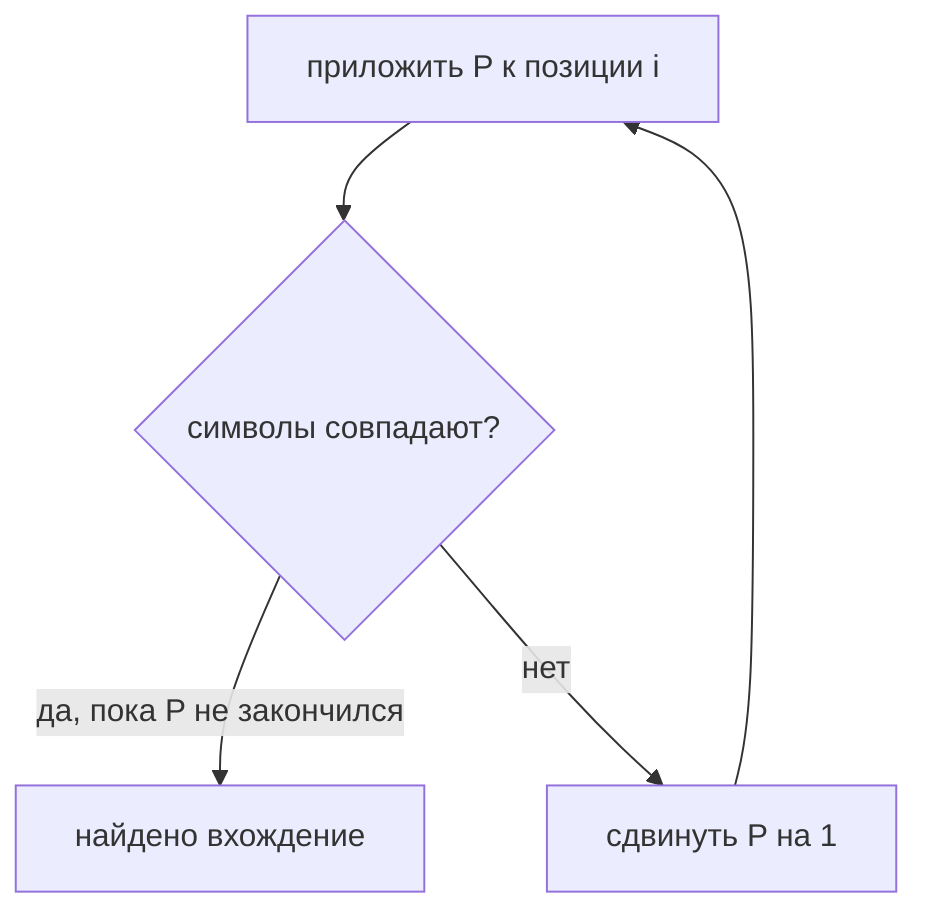
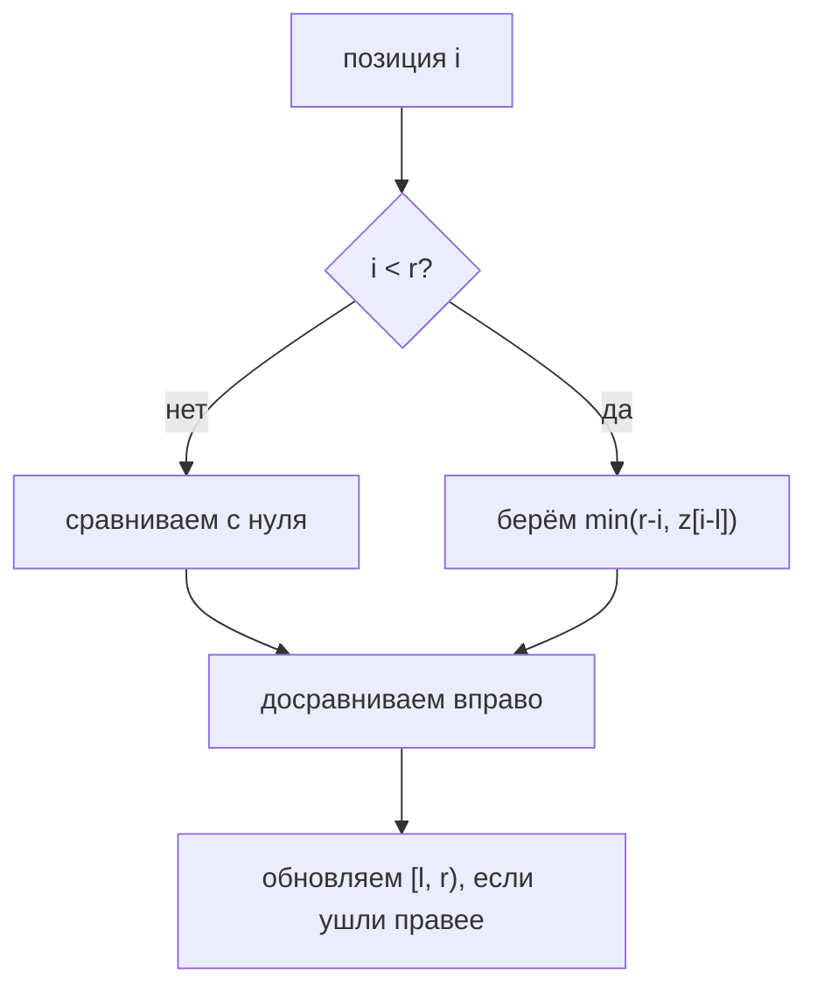
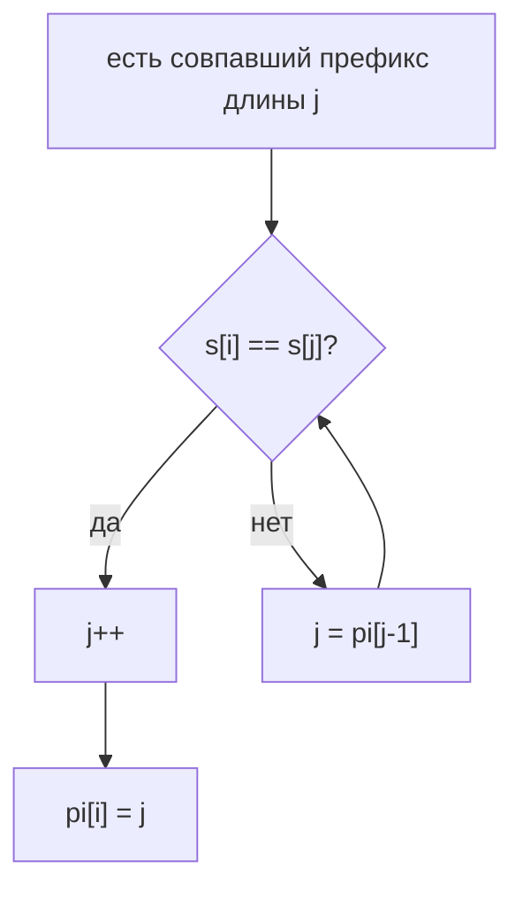
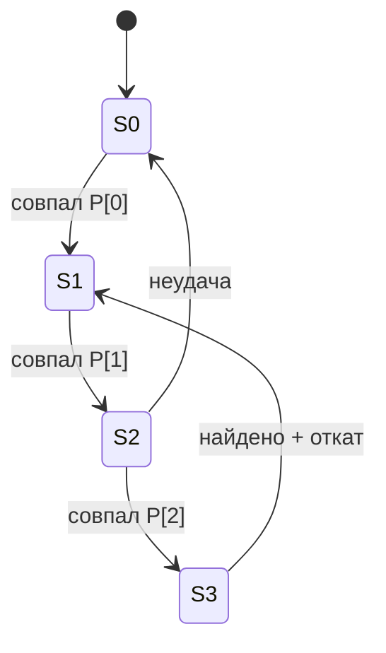
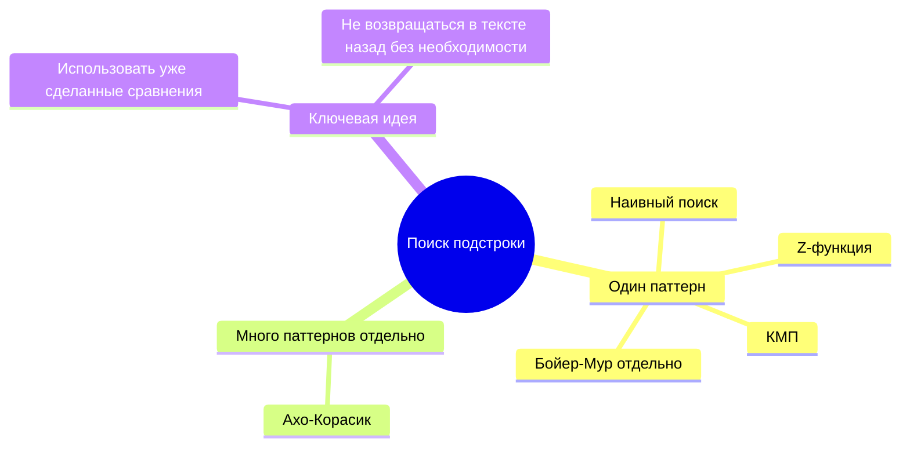

# Глава 8. Поиск подстроки

## 8.1 Базовые определения

Пусть есть строка:

```text
s = s[0] s[1] ... s[n-1]
```

**Подстрока** — непрерывный кусок строки:

```text
s[l..r] = s[l] s[l+1] ... s[r]
```

**Подпоследовательность** — символы, взятые слева направо, но не обязательно подряд.

Пример для `abcdef`:

| Объект                | Пример | Почему                                   |
| --------------------- | ------ | ---------------------------------------- |
| Подстрока             | `bcd`  | символы идут подряд                      |
| Подпоследовательность | `ace`  | символы идут по порядку, но с пропусками |

**Префикс** строки — подстрока, начинающаяся в начале:

```text
s[0..k]
```

**Суффикс** строки — подстрока, заканчивающаяся в конце:

```text
s[k..n-1]
```

В задачах поиска обычно есть:

- `T` — текст длины `n`;
- `P` — паттерн, или образец, длины `m`.

Нужно найти все позиции `i`, где:

$$
T[i..i+m-1] = P
$$

## 8.2 Наивный поиск

Самый простой алгоритм прикладывает паттерн к каждой позиции текста и сравнивает символы слева направо.

```text
naive_search(T, P):
    for start = 0..n-m:
        ok = true
        for j = 0..m-1:
            if T[start+j] != P[j]:
                ok = false
                break
        if ok:
            report(start)
```

Сложность в худшем случае:

$$
O(nm)
$$

Плохой пример:

```text
T = aaaaaaaaaaaaaaaaaab
P = aaaaaab
```

Почти на каждой позиции алгоритм долго сравнивает `a`, а потом падает на последнем символе.



Главная идея быстрых алгоритмов: после несовпадения использовать уже сделанные сравнения, а не начинать почти с нуля.

## 8.3 Z-функция

`Z[i]` — длина наибольшего общего префикса строк `s` и `s[i..]`.

То есть:

$$
Z[i] = LCP(s, s[i..])
$$

Обычно `Z[0]` либо не определяют, либо считают равным `0`.

Пример:

```text
s = abacaba
```

| i | suffix s[i..] | Z[i] |
|---:|---|---:|
| 0 | abacaba | 0 |
| 1 | bacaba | 0 |
| 2 | acaba | 1 |
| 3 | caba | 0 |
| 4 | aba | 3 |
| 5 | ba | 0 |
| 6 | a | 1 |

## 8.4 Линейное построение Z-функции

Поддерживаем самый правый уже найденный отрезок совпадения с префиксом:

```text
[l, r)
```

Это значит:

```text
s[l..r-1] = s[0..r-l-1]
```

Для новой позиции `i` есть два случая.

### Случай 1: i вне текущего отрезка

Если `i >= r`, про позицию ничего не знаем. Сравниваем символы напрямую:

```text
while i + z[i] < n and s[z[i]] == s[i + z[i]]:
    z[i]++
```

Если получилось ненулевое значение, обновляем `[l, r)`.

### Случай 2: i внутри текущего отрезка

Если `i < r`, то часть ответа можно взять из уже посчитанной Z-функции.

Позиция `i` внутри отрезка соответствует позиции:

```text
i - l
```

Минимально известно:

```text
z[i] = min(r - i, z[i - l])
```

Если значение упёрлось в правую границу `r`, дальше снова сравниваем символы напрямую.

```text
z_function(s):
    n = len(s)
    z[0] = 0
    l = 0
    r = 0

    for i = 1..n-1:
        if i < r:
            z[i] = min(r - i, z[i-l])

        while i + z[i] < n and s[z[i]] == s[i + z[i]]:
            z[i]++

        if i + z[i] > r:
            l = i
            r = i + z[i]

    return z
```



Сложность `O(n)`: правая граница `r` за весь алгоритм двигается только вправо, поэтому суммарное число досравнений линейно.

## 8.5 Поиск подстроки через Z-функцию

Склеим:

```text
S = P + "#" + T
```

где `#` — специальный символ, которого нет ни в паттерне, ни в тексте.

Если для позиции `i` в этой строке:

```text
Z[i] == len(P)
```

то в тексте найдено вхождение паттерна.

```text
search_by_z(T, P):
    S = P + "#" + T
    z = z_function(S)
    for i = len(P) + 1 .. len(S)-1:
        if z[i] == len(P):
            report(i - len(P) - 1)
```

Сложность:

$$
O(n+m)
$$

Минус подхода: нужно хранить склеенную строку и Z-массив длины `n+m+1`.

## 8.6 Префикс-функция

Префикс-функция `pi[i]` — длина наибольшего собственного префикса строки `s[0..i]`, который одновременно является её суффиксом.

Для `s = ababa`:

| i | s[0..i] | pi[i] |
|---:|---|---:|
| 0 | a | 0 |
| 1 | ab | 0 |
| 2 | aba | 1 |
| 3 | abab | 2 |
| 4 | ababa | 3 |

Смысл: если мы уже совпали с префиксом длины `j`, а следующий символ не подошёл, можно откатиться к более короткому префиксу, который одновременно является суффиксом уже совпавшей части.

```text
prefix_function(s):
    pi[0] = 0
    for i = 1..len(s)-1:
        j = pi[i-1]

        while j > 0 and s[i] != s[j]:
            j = pi[j-1]

        if s[i] == s[j]:
            j++

        pi[i] = j

    return pi
```



Сложность `O(n)`.

## 8.7 Сильная префикс-функция

В лекциях отдельно появляется идея **сильной** префикс-функции: при несовпадении хочется откатиться не просто к максимальной границе, а к такой, после которой следующий символ точно не повторяет уже провалившийся символ.

Обычная префикс-функция говорит:

```text
какой максимальный префикс совпадает с суффиксом
```

Сильная версия дополнительно учитывает символ после этого префикса. Это помогает не делать заведомо бесполезный сдвиг.

Практически для реализации КМП обычно достаточно стандартной `pi`: она уже даёт линейное время. Сильная версия полезна для объяснения сдвигов и связи с Бойер-Муром.

## 8.8 КМП

КМП ищет один паттерн в тексте за `O(n+m)`.

Инвариант:

```text
j = сколько первых символов P уже совпало с суффиксом просмотренной части T
```

Когда читаем очередной символ `T[i]`:

1. если `T[i] == P[j]`, увеличиваем `j`;
2. если не совпало, откатываем `j` по префикс-функции;
3. если `j == m`, нашли вхождение.

```text
kmp(T, P):
    pi = prefix_function(P)
    j = 0

    for i = 0..len(T)-1:
        while j > 0 and T[i] != P[j]:
            j = pi[j-1]

        if T[i] == P[j]:
            j++

        if j == len(P):
            report(i - len(P) + 1)
            j = pi[j-1]
```

Почему после найденного вхождения нужен откат:

```text
P = aba
T = ababa
```

Вхождения начинаются в позициях `0` и `2`. Если после первого вхождения просто обнулить `j`, второе перекрывающееся вхождение можно потерять.

## 8.9 КМП как автомат

КМП можно понимать как автомат по префиксам паттерна.

Состояние `j` означает: совпал префикс длины `j`.



Префикс-функция задаёт переходы по неудаче. Эта точка важна для следующей темы: [[8.2-Ахо-Корасик]] обобщает этот автомат с одного паттерна на целый набор паттернов.

## 8.10 Что читать дальше

В этой главе разобраны базовые линейные инструменты: Z-функция, префикс-функция и КМП. Два следующих алгоритма вынесены отдельно, потому что в лекциях им соответствует большой самостоятельный кусок:

| Глава | Что внутри |
|---|---|
| [[8.1-Бойер-Мур]] | сравнение справа налево, плохой символ, хороший суффикс, таблицы сдвигов |
| [[8.2-Ахо-Корасик]] | бор паттернов, связи неудачи, выходные ссылки, поиск многих паттернов |

## 8.11 Сравнение алгоритмов

| Алгоритм            | Что ищет        | Предобработка |          Поиск | Когда полезен                |                    |                                  |
| ------------------- | --------------- | ------------: | -------------: | ---------------------------- | ------------------ | -------------------------------- |
| Наивный             | один паттерн    |           нет |        `O(nm)` | маленькие строки             |                    |                                  |
| Z-функция           | один паттерн    |      `O(n+m)` | включено в неё | просто реализовать           |                    |                                  |
| КМП                 | один паттерн    |        `O(m)` |         `O(n)` | потоковый поиск, мало памяти |                    |                                  |
| [[8.1-Бойер-Мур]]   | один паттерн    |        `O(m + |              Σ | )`                           | быстро на практике | большие тексты                   |
| [[8.2-Ахо-Корасик]] | много паттернов |          `O(Σ |            P_i | )`                           | `O(n + answers)`   | словари, фильтры, много образцов |

## 8.12 Типовые ошибки

- Путать подстроку и подпоследовательность.
- В Z-функции забыть ограничение `min(r-i, z[i-l])`.
- В КМП после найденного вхождения поставить `j = 0` и потерять перекрывающиеся ответы.

## 8.13 Мини-карта


