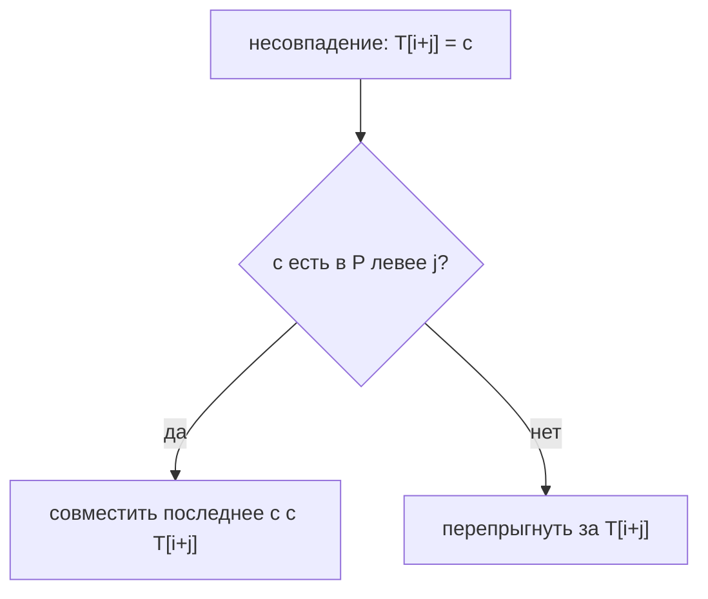
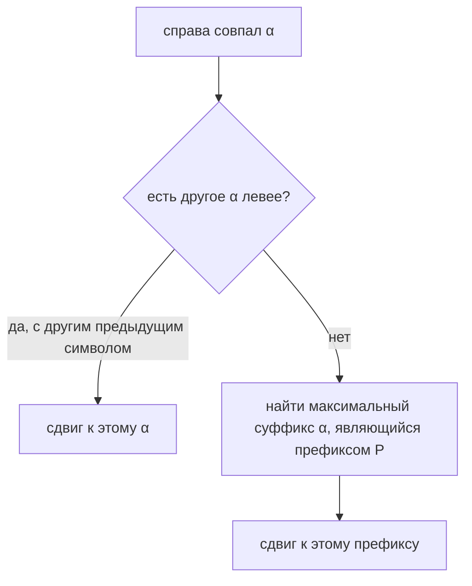

# Глава 8.1. Алгоритм Бойера-Мура

## 8.1.1 Мотивация

КМП гарантированно просматривает текст слева направо и работает за линейное время. Но на практике часто хочется большего: не просто не возвращаться назад, а **перепрыгивать через большие куски текста**.

Алгоритм Бойера-Мура делает ровно это. Он прикладывает паттерн к тексту, но сравнивает символы **справа налево**.

```text
T: ... a b c d e f ...
P:     x y c d e f
              ^ сначала сравниваем правый конец
```

Если справа быстро нашлось несовпадение, часто можно сдвинуть паттерн сразу на несколько позиций.

## 8.1.2 Общая схема

Пусть:

- `T` — текст длины `n`;
- `P` — паттерн длины `m`;
- `i` — позиция, куда сейчас приложено начало паттерна.

Алгоритм:

```text
boyer_moore(T, P):
    preprocess_bad_character(P)
    preprocess_good_suffix(P)

    i = 0
    while i <= n - m:
        j = m - 1

        while j >= 0 and P[j] == T[i+j]:
            j--

        if j < 0:
            report(i)
            i += shift_after_full_match
        else:
            bad = bad_character_shift(j, T[i+j])
            good = good_suffix_shift(j)
            i += max(1, bad, good)
```

Две эвристики дают два кандидата на сдвиг:

| Эвристика | Что использует |
|---|---|
| Плохой символ | символ текста, на котором случилось несовпадение |
| Хороший суффикс | уже совпавшую правую часть паттерна |

Берём максимум, потому что оба сдвига безопасны.

## 8.1.3 Почему сравниваем справа налево

Если сравнивать слева направо, при несовпадении мы обычно знаем мало: совпал короткий префикс.

Если сравнивать справа налево, при несовпадении мы знаем, что **целый суффикс паттерна уже совпал**.

```text
T: ... ? ? ? a b c d
P:     x y z a b c d
              \_____/
            хороший суффикс
```

Эту информацию можно использовать для сдвига.

## 8.1.4 Эвристика плохого символа

Пусть несовпадение произошло в позиции `j` паттерна:

```text
T: ... c ...
P: ... x ...
       ^ j, x != c
```

Символ `c = T[i+j]` называется плохим символом.

Идея: если `c` встречается в паттерне левее позиции `j`, можно сдвинуть паттерн так, чтобы это вхождение `c` оказалось под символом текста `c`.

Если `c` в паттерне нет, можно сдвинуть паттерн целиком за этот символ.

## 8.1.5 Таблица last

Для каждого символа алфавита храним его последнюю позицию в паттерне.

```text
last[c] = max position p such that P[p] == c
```

Если символа нет:

```text
last[c] = -1
```

Построение:

```text
build_last(P):
    for c in alphabet:
        last[c] = -1

    for i = 0..m-1:
        last[P[i]] = i
```

Сдвиг:

```text
bad_shift(j, c):
    return max(1, j - last[c])
```

## 8.1.6 Пример плохого символа

```text
T:  a b c x y z
P:  a b d
        ^
```

Сравниваем справа:

```text
P[2] = d
T[2] = c
```

Символ `c` в паттерне `abd` не встречается. Значит, нет смысла ставить паттерн так, чтобы он всё ещё покрывал этот `c`: никакая позиция паттерна не сможет с ним совпасть.

Сдвигаем на `j + 1 = 3`.



## 8.1.7 Ограничение плохого символа

Эвристика плохого символа не всегда даёт большой сдвиг.

Пример:

```text
P = aaaaab
T = aaaaaaaaaaaaa
```

Плохой символ `a` часто встречается в паттерне, поэтому сдвиги могут быть маленькими. Нужна вторая эвристика — хороший суффикс.

## 8.1.8 Хороший суффикс

Пусть справа совпала строка `α`, а перед ней случилось несовпадение:

```text
T: ... b α ...
P: ... a α
       ^ a != b
```

`α` — хороший суффикс: мы точно знаем, что он совпал с текстом.

Есть два варианта безопасного сдвига:

1. найти другое вхождение `α` в паттерне левее;
2. если такого нет, совместить с текстом максимальный суффикс `α`, который является префиксом паттерна.

## 8.1.9 Правило хорошего суффикса: вариант 1

Если `α` встречается в паттерне левее и перед этим вхождением стоит символ, отличный от `a`, можно сдвинуть паттерн к этому вхождению.

```text
P: ... b α ... a α
       ^       ^
       можно   текущее место
```

Почему нужен другой предыдущий символ: если перед левым `α` тоже стоит `a`, то после сдвига мы снова поставим `a` под текстовый `b` и сразу получим то же несовпадение.

## 8.1.10 Правило хорошего суффикса: вариант 2

Если `α` больше нигде не встречается, всё равно может быть полезен её суффикс.

Например:

```text
P = abcdab
```

Суффикс `ab` одновременно является префиксом паттерна. Если справа совпал большой суффикс, но его нельзя переиспользовать целиком, можно совместить с текстом его часть, которая является префиксом.



## 8.1.11 Функция N через Z-функцию

В лекциях для правила хорошего суффикса появляется функция `N`.

Смысл:

```text
N[i] = длина наибольшего суффикса P[0..i],
       который одновременно является суффиксом всего P
```

Удобный способ посчитать `N`:

1. перевернуть паттерн;
2. посчитать Z-функцию на перевёрнутом паттерне;
3. отразить индексы обратно.

```text
P      = a b c a b
rev(P) = b a c b a
```

Так задача про суффиксы превращается в задачу про префиксы, а Z-функция как раз умеет быстро считать совпадение с префиксом.

## 8.1.12 Таблица L: правое вхождение хорошего суффикса

Таблица `L[i]` отвечает на вопрос:

```text
если совпал суффикс P[i..m-1],
где находится его самое правое подходящее вхождение левее?
```

Подходящее означает: символ перед найденным вхождением отличается от символа перед суффиксом.

Иначе сдвиг не даст новой информации.

Идея построения через `N`:

```text
for j = 0..m-2:
    len = N[j]
    if len > 0:
        i = m - len
        L[i] = j
```

В разных учебниках индексация может отличаться. Главное понимать смысл: `L` ищет правое внутреннее вхождение уже совпавшего суффикса.

## 8.1.13 Таблица small_l: префикс как суффикс

Если внутреннего вхождения нет, нужна другая таблица:

```text
small_l[i] = длина наибольшего суффикса P[i..m-1],
             который является префиксом P
```

Она отвечает за второй вариант хорошего суффикса.

Пример:

```text
P = abacab
```

Суффикс `ab` является префиксом. Если большой хороший суффикс не удалось совместить с внутренним вхождением, можно сдвинуть паттерн так, чтобы этот `ab` оказался под уже совпавшей частью текста.

## 8.1.14 Сдвиг хорошего суффикса

Пусть несовпадение в позиции `j`. Тогда хороший суффикс:

```text
P[j+1..m-1]
```

Если он пустой, правило хорошего суффикса обычно даёт сдвиг `1`.

Иначе:

```text
good_suffix_shift(j):
    i = j + 1
    if L[i] exists:
        return m - 1 - L[i]
    return m - small_l[i]
```

Смысл:

- если есть внутреннее подходящее вхождение, совмещаем с ним;
- иначе совмещаем максимальный префикс паттерна с суффиксом уже совпавшей части.

## 8.1.15 Полный шаг Бойера-Мура

```text
search(T, P):
    last = build_last(P)
    L, small_l = build_good_suffix_tables(P)

    i = 0
    while i <= n - m:
        j = m - 1

        while j >= 0 and P[j] == T[i+j]:
            j--

        if j < 0:
            report(i)
            i += m - small_l[1]
        else:
            bad = max(1, j - last[T[i+j]])
            good = good_suffix_shift(j)
            i += max(bad, good)
```

## 8.1.16 Мини-пример работы

```text
T = here is a simple example
P = example
```

На первой позиции сравниваем справа:

```text
T: here is a simple example
P: example
        ^
```

Правый символ паттерна `e` сравнивается с символом текста под ним. Если это символ, которого нет в паттерне, эвристика плохого символа сразу переносит паттерн правее.

Поэтому Бойер-Мур часто делает меньше сравнений, чем длина текста, хотя худшие случаи требуют аккуратного анализа.

## 8.1.17 Сложность

Предобработка:

| Таблица | Время | Память |
|---|---:|---:|
| `last` | `O(m + |Σ|)` или `O(m)` с map | `O(|Σ|)` или `O(число разных символов)` |
| `N`, `L`, `small_l` | `O(m)` | `O(m)` |

Поиск:

- на практике часто очень быстрый;
- плохой символ без хорошего суффикса не гарантирует хорошее поведение;
- полные варианты Бойера-Мура имеют линейную оценку при корректной реализации правил;
- Апостолико-Джанкарло хранит дополнительную информацию о совпавших участках, чтобы проще контролировать повторные сравнения.

## 8.1.18 Бойер-Мур vs КМП

| Свойство | КМП | Бойер-Мур |
|---|---|---|
| Направление сравнения | слева направо | справа налево |
| Главная идея | откат по префикс-функции | большие сдвиги |
| Память | `O(m)` | `O(m + |Σ|)` |
| Поведение на практике | стабильно линейное | часто быстрее |
| Много паттернов | не подходит напрямую | не подходит напрямую |

Для многих паттернов смотри [[8.2-Ахо-Корасик]].

## 8.1.19 Типовые ошибки

- Использовать только плохой символ и думать, что реализован полный Бойер-Мур.
- Забывать `max(1, shift)`, из-за чего алгоритм может не сдвинуться.
- Путать направление сравнения: Бойер-Мур сравнивает справа налево.
- Неверно обрабатывать полное совпадение паттерна.
- Строить таблицу `last` размером по огромному Unicode-алфавиту, хотя достаточно hash map.
- Ошибиться в индексах таблиц хорошего суффикса: их лучше проверять на коротких паттернах вручную.

