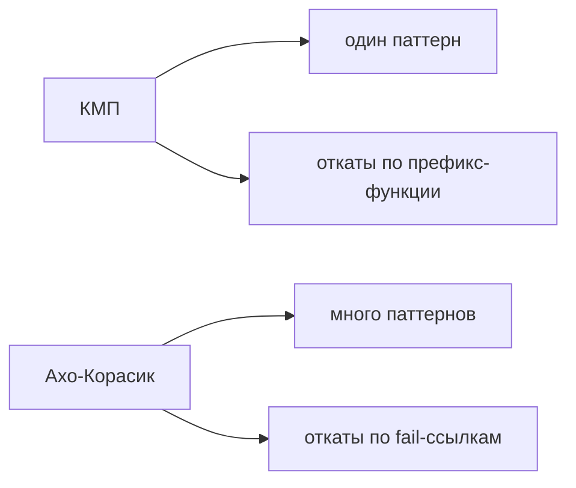
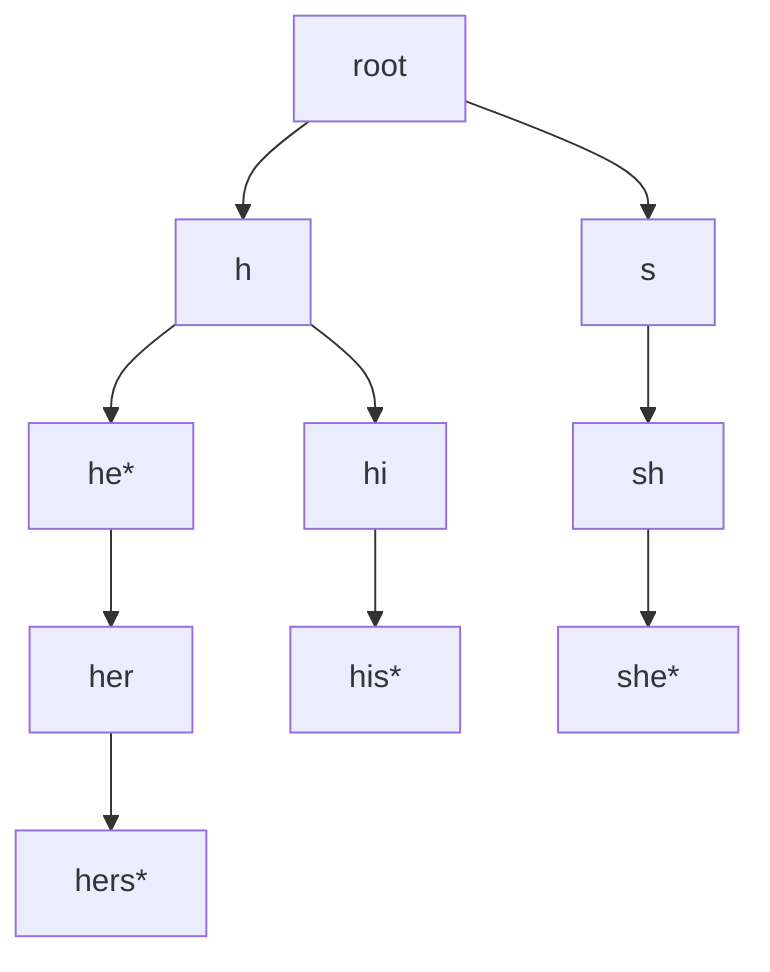
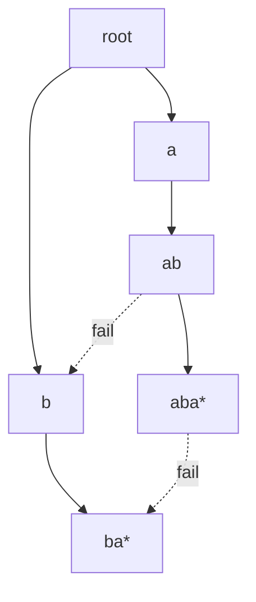
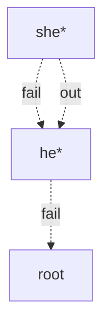
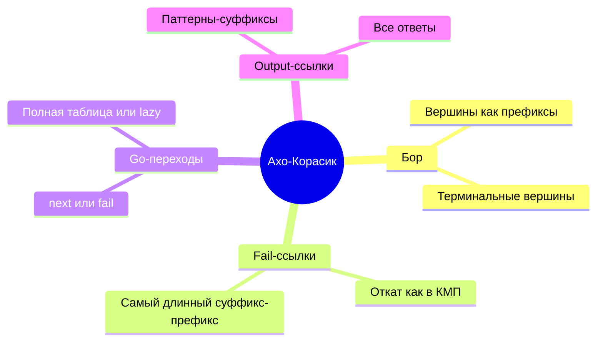

# Глава 8.2. Алгоритм Ахо-Корасик

## 8.2.1 Зачем нужен Ахо-Корасик

КМП ищет один паттерн в тексте за `O(n + m)`.

Если паттернов много:

```text
P1, P2, ..., Pk
```

запускать КМП для каждого паттерна отдельно дорого:

$$
O(k \cdot |T| + \sum |P_i|)
$$

Ахо-Корасик строит автомат по всем паттернам и проходит по тексту один раз:

$$
O(|T| + \sum |P_i| + \text{число ответов})
$$

## 8.2.2 Связь с КМП

КМП можно представить как автомат по одному паттерну:

- состояние — длина совпавшего префикса;
- при неудаче откатываемся к максимальному суффиксу, который является префиксом.

Ахо-Корасик делает то же самое, но вместо одной цепочки паттерна использует бор всех паттернов.



## 8.2.3 Бор паттернов

Первый шаг — построить бор.

Пример:

```text
patterns = ["he", "she", "his", "hers"]
```



Звёздочка означает терминальную вершину: в ней заканчивается паттерн.

## 8.2.4 Вставка паттерна в бор

```text
add_pattern(pattern, id):
    v = root
    for c in pattern:
        if next[v][c] does not exist:
            create new vertex
            next[v][c] = new vertex
        v = next[v][c]
    terminal[v].push(id)
```

В одной вершине может заканчиваться несколько паттернов, если в наборе есть одинаковые строки или если так хранится несколько идентификаторов.

Суммарное число вершин не больше:

$$
1 + \sum |P_i|
$$

## 8.2.5 Почему одного бора недостаточно

Наивно можно стартовать из каждой позиции текста и идти по бору вниз.

```text
for start = 0..n-1:
    v = root
    for i = start..n-1:
        if no edge by T[i]:
            break
        v = go(v, T[i])
        if terminal[v]:
            report
```

В худшем случае это снова много лишней работы.

Пример:

```text
patterns = ["aaaaa"]
T = "aaaaaaaaaaaaaaaa"
```

Из каждой позиции мы долго идём по одним и тем же символам.

Нужны ссылки, которые позволяют не начинать заново.

## 8.2.6 Связь неудачи

Для вершины `v` пусть `str(v)` — строка на пути от корня до `v`.

`fail[v]` — вершина, соответствующая самому длинному собственному суффиксу `str(v)`, который является префиксом какого-то паттерна.

```text
str(v) = "ababa"
суффиксы: "baba", "aba", "ba", "a"
fail[v] -> вершина для самого длинного из них, который есть в боре
```

Это прямой аналог отката в КМП.



## 8.2.7 Построение fail-ссылок BFS-ом

Ссылки строятся по возрастанию глубины. Поэтому используется очередь.

Для ребра:

```text
v --c--> to
```

мы уже знаем `fail[v]` и хотим найти `fail[to]`.

Алгоритм:

```text
build_fail():
    queue = empty
    fail[root] = root

    for each edge root --c--> child:
        fail[child] = root
        queue.push(child)

    while queue not empty:
        v = queue.pop()

        for each edge v --c--> to:
            u = fail[v]

            while u != root and no edge u --c-->:
                u = fail[u]

            if edge u --c--> exists:
                fail[to] = next[u][c]
            else:
                fail[to] = root

            queue.push(to)
```

## 8.2.8 Автоматные переходы go

В реализации удобно различать:

| Обозначение | Смысл |
|---|---|
| `next[v][c]` | реальное ребро бора |
| `go[v][c]` | переход автомата по символу `c` с учётом fail-ссылок |

Переход автомата:

```text
go(v, c):
    if next[v][c] exists:
        return next[v][c]
    if v == root:
        return root
    return go(fail[v], c)
```

С мемоизацией каждый `go[v][c]` считается один раз.

Если алфавит маленький, можно заранее построить таблицу `go[vertex][char]`. Если алфавит большой, лучше хранить словари и вычислять переходы лениво.

## 8.2.9 Построение go через BFS

Для маленького алфавита:

```text
build_go():
    for c in alphabet:
        if next[root][c] exists:
            go[root][c] = next[root][c]
        else:
            go[root][c] = root

    BFS over vertices:
        for c in alphabet:
            if next[v][c] exists:
                go[v][c] = next[v][c]
            else:
                go[v][c] = go[fail[v]][c]
```

Тогда обработка каждого символа текста становится просто:

```text
v = go[v][T[i]]
```

## 8.2.10 Терминальные вершины

Если автомат пришёл в терминальную вершину, значит найден паттерн.

Пусть в вершине `v` заканчивается паттерн длины `len`.

Если мы сейчас на позиции `i` текста, начало вхождения:

```text
i - len + 1
```

```text
report all ids in terminal[v]:
    start = i - pattern_length[id] + 1
```

## 8.2.11 Зачем нужны выходные ссылки

Паттерн может быть суффиксом другого паттерна.

Пример:

```text
patterns = ["he", "she"]
T = "she"
```

Когда мы прочитали `she`, нужно сообщить оба паттерна:

- `she`;
- `he`.

Но текущая вершина соответствует `she`. Паттерн `he` находится на цепочке fail-ссылок.

Если каждый раз идти по всей цепочке fail-ссылок, можно получить лишнюю работу. Поэтому вводят **выходные ссылки**.

## 8.2.12 Выходная ссылка

`out[v]` ведёт к ближайшей терминальной вершине на пути по fail-ссылкам.

```text
if fail[v] is terminal:
    out[v] = fail[v]
else:
    out[v] = out[fail[v]]
```

Если такой вершины нет:

```text
out[v] = null
```



## 8.2.13 Построение выходных ссылок

Так как `out[v]` зависит от `fail[v]`, удобно строить их в том же BFS-порядке, что и fail-ссылки.

```text
build_output_links():
    out[root] = null

    BFS over vertices except root:
        f = fail[v]
        if terminal[f] is not empty:
            out[v] = f
        else:
            out[v] = out[f]
```

## 8.2.14 Поиск по тексту

```text
search(T):
    v = root

    for i = 0..len(T)-1:
        c = T[i]
        v = go(v, c)

        report_terminal(v, i)

        u = out[v]
        while u != null:
            report_terminal(u, i)
            u = out[u]
```

Где:

```text
report_terminal(v, i):
    for id in terminal[v]:
        start = i - len(pattern[id]) + 1
        report(id, start)
```

## 8.2.15 Полная сложность

Пусть:

- `S = sum |P_i|` — суммарная длина паттернов;
- `V` — число вершин бора;
- `A = |Σ|` — размер алфавита;
- `ans` — число найденных вхождений.

| Этап | Сложность |
|---|---:|
| Построить бор | `O(S)` |
| Построить fail-ссылки | `O(S)` при словарях и амортизированных переходах |
| Построить полную таблицу go | `O(V * A)` |
| Поиск | `O(|T| + ans)` |

Память:

- бор: `O(S)`;
- fail/out: `O(V)`;
- полная таблица `go`: `O(V * A)`, если строится массивом.

## 8.2.16 Пример поиска

Паттерны:

```text
he, she, his, hers
```

Текст:

```text
ushers
```

Идём по символам:

| i | символ | состояние | ответы |
|---:|---|---|---|
| 0 | u | root | - |
| 1 | s | s | - |
| 2 | h | sh | - |
| 3 | e | she | `she`, `he` через out/fail |
| 4 | r | her | - |
| 5 | s | hers | `hers` |

Ответы:

```text
she at 1
he at 2
hers at 2
```

## 8.2.17 Если один паттерн

Если в боре только один паттерн, Ахо-Корасик почти превращается в КМП:

- вершины бора — префиксы паттерна;
- fail-ссылки — откаты по префикс-функции;
- поиск — движение по автомату.

Поэтому Ахо-Корасик можно считать многопаттерновым обобщением КМП.

## 8.2.18 Практическая структура вершины

Для маленького алфавита:

```cpp
struct Node {
    int next[ALPHABET];
    int go[ALPHABET];
    int fail;
    int out;
    vector<int> terminal;
};
```

Для большого алфавита:

```cpp
struct Node {
    unordered_map<char, int> next;
    unordered_map<char, int> go;
    int fail;
    int out;
    vector<int> terminal;
};
```

Первый вариант быстрее, второй экономит память.

## 8.2.19 Типовые ошибки

- Сообщать только текущую терминальную вершину и забывать паттерны на output-ссылках.
- Идти по fail-ссылкам после каждого символа полностью и получить лишнюю работу.
- Путать `next` и `go`: `next` — ребро бора, `go` — переход автомата.
- Не хранить длину паттерна, из-за чего невозможно восстановить старт позиции.
- Строить массив `go[V][A]` при огромном алфавите.
- Не учитывать, что в одной вершине может закончиться несколько паттернов.

## 8.2.20 Мини-карта



