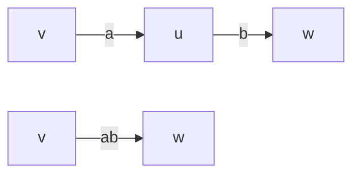
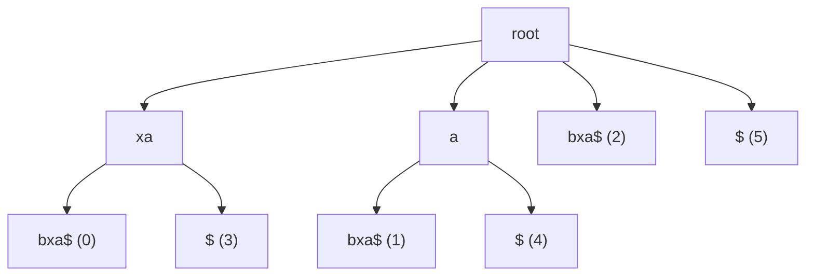
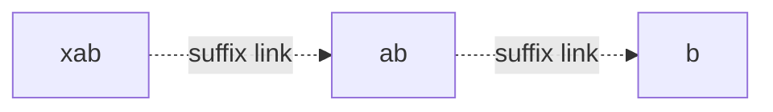
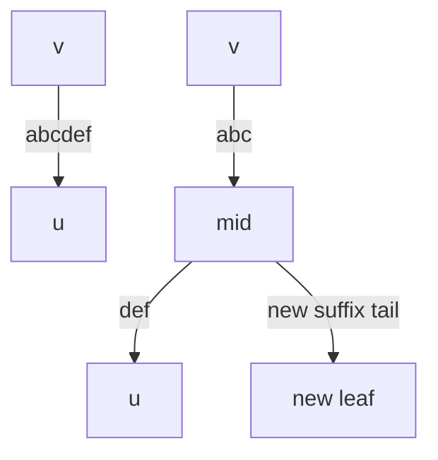
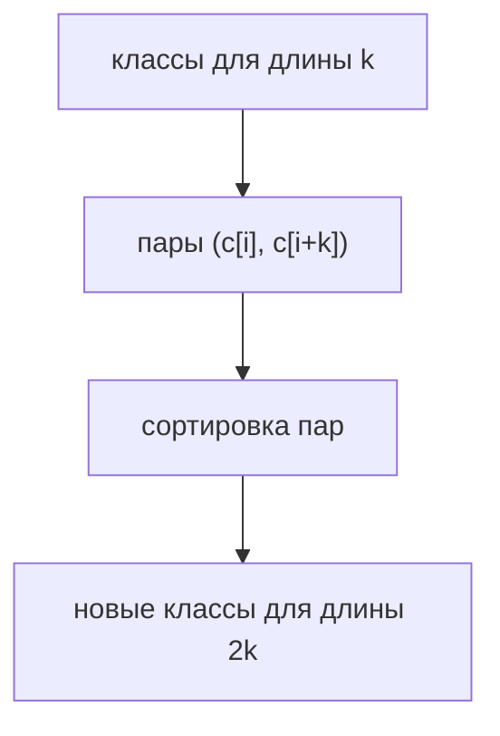
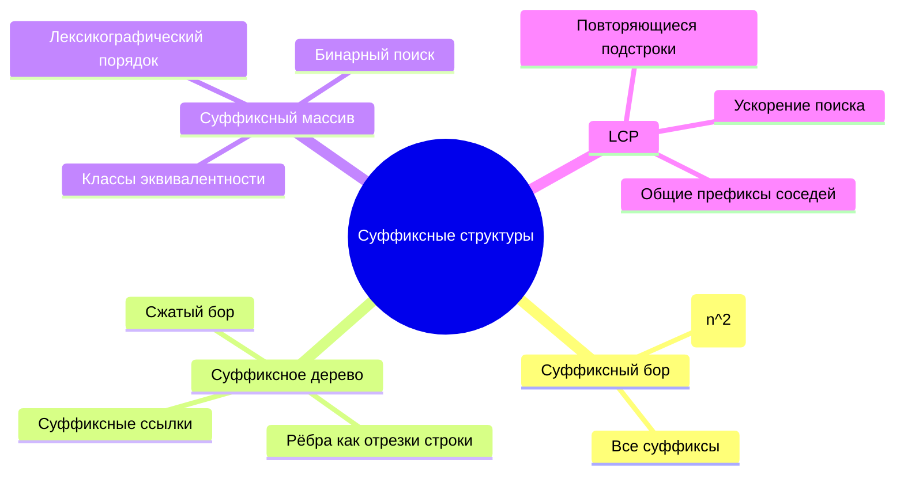

# Глава 9. Суффиксные структуры

## 9.1 Какая задача решается

В предыдущих главах мы чаще рассматривали ситуацию:

```text
есть паттерн или набор паттернов -> ищем их в разных текстах
```

Например, КМП предварительно обрабатывает паттерн, а потом ищет его в тексте. Ахо-Корасик предварительно обрабатывает набор паттернов.

В этой главе другая постановка:

```text
есть фиксированный большой текст -> к нему приходят разные запросы-паттерны
```

Хочется один раз построить структуру по тексту, а потом быстро отвечать:

- входит ли паттерн в текст;
- где он входит;
- сколько раз он входит;
- какие подстроки повторяются;
- какие суффиксы идут в лексикографическом порядке.

Именно для этого нужны суффиксные структуры.

## 9.2 Суффиксы и sentinel

Суффикс строки `s` — подстрока, начинающаяся в некоторой позиции и идущая до конца:

```text
s[i..n-1]
```

Для строки:

```text
s = xabxa
```

суффиксы:

| Позиция | Суффикс |
|---:|---|
| 0 | xabxa |
| 1 | abxa |
| 2 | bxa |
| 3 | xa |
| 4 | a |

Проблема: один суффикс может быть префиксом другого. Чтобы все суффиксы заканчивались явно, добавляют специальный символ `$`, которого нет в алфавите:

```text
s = xabxa$
```

Теперь суффиксы:

| Позиция | Суффикс |
|---:|---|
| 0 | xabxa$ |
| 1 | abxa$ |
| 2 | bxa$ |
| 3 | xa$ |
| 4 | a$ |
| 5 | $ |

> [!important]
> `$` считают лексикографически меньшим любого обычного символа и уникальным терминатором строки.

## 9.3 Суффиксный бор

Самая прямолинейная структура — построить бор всех суффиксов.

```text
for i = 0..n-1:
    add s[i..n-1] to trie
```

Для строки `xabxa$` бор содержит пути:

```text
xabxa$
abxa$
bxa$
xa$
a$
$
```

Поиск паттерна в таком боре прост:

1. стартуем из корня;
2. идём по символам паттерна;
3. если ребро отсутствует, паттерна нет;
4. если все символы паттерна прочитаны, паттерн входит в текст.

Проблема: суммарная длина всех суффиксов:

$$
1 + 2 + \dots + n = O(n^2)
$$

Обычный суффиксный бор слишком большой.

## 9.4 Сжатый бор и суффиксное дерево

Суффиксное дерево — это **сжатый бор всех суффиксов**.

Сжатие: если внутренняя вершина имеет ровно одного ребёнка, её можно убрать, а два ребра склеить в одно.



После сжатия ребро может быть помечено не одним символом, а целой строкой.

На практике строку на ребре не копируют, а хранят отрезок исходной строки:

```text
edge = (left, right)
label = s[left..right]
```

Так структура остаётся компактной.

## 9.5 Свойства суффиксного дерева

Для строки длины `n` с добавленным `$` суффиксное дерево имеет свойства:

1. В дереве ровно `n` листьев: по одному на каждый суффикс.
2. Каждый лист помечен позицией суффикса.
3. Каждая внутренняя вершина, кроме корня, имеет минимум двух детей.
4. Из одной вершины не выходят два ребра, начинающиеся с одной и той же буквы.
5. Путь от корня до листа `i` даёт суффикс `s[i..n-1]`.



Это схематичное дерево для `xabxa$`: подписи в листьях показывают стартовые позиции суффиксов.

## 9.6 Почему дерево линейного размера

Листьев `n`.

Каждая внутренняя вершина имеет хотя бы двух детей. В дереве с `n` листьями и без внутренних вершин степени 1 число внутренних вершин меньше `n`.

Значит, вершин:

$$
O(n)
$$

Рёбер тоже `O(n)`. Если на ребре хранить пару индексов `(l, r)`, а не копию подстроки, память получается линейной.

## 9.7 Поиск паттерна в суффиксном дереве

Чтобы проверить, входит ли паттерн `P` в текст:

1. начинаем в корне;
2. выбираем ребро по текущему символу;
3. сравниваем паттерн с подписью ребра;
4. если подпись закончилась, переходим в следующую вершину;
5. если паттерн закончился, он найден.

```text
contains(P):
    v = root
    pos = 0

    while pos < len(P):
        c = P[pos]
        if no edge from v starting with c:
            return false

        e = edge from v starting with c
        for x in label(e):
            if pos == len(P):
                return true
            if P[pos] != x:
                return false
            pos++

        v = e.to

    return true
```

Сложность:

$$
O(|P|)
$$

Если нужно вывести все позиции вхождения, после окончания паттерна нужно собрать все листья в текущем поддереве.

## 9.8 Построение: наивно и не наивно

Наивное построение:

```text
for i = 0..n-1:
    insert suffix s[i..n-1]
```

Даже со сжатием это может быть медленно, если каждый раз искать место вставки с корня.

В лекциях обсуждается идея ускорения через **суффиксные ссылки**: когда мы добавили суффикс, следующий суффикс отличается от него удалением первого символа. Не хочется начинать поиск заново из корня.

```text
xabxa$
 abxa$
  bxa$
   xa$
    a$
     $
```

Переход от одной строки к следующей — это "отрезать первый символ".

## 9.9 Суффиксная ссылка

Если вершина соответствует строке:

```text
cα
```

то её суффиксная ссылка ведёт в вершину, соответствующую:

```text
α
```

Пример:

```text
"xab" -> "ab"
"ab"  -> "b"
```



Суффиксные ссылки позволяют после обработки одного суффикса быстро перейти к месту, полезному для следующего суффикса.

## 9.10 Что происходит при вставке нового суффикса

При вставке возможны случаи:

1. Путь уже есть целиком: нужно только отметить лист/терминатор.
2. На очередной букве нет ребра: создаём новый лист.
3. Несовпадение произошло внутри ребра: ребро нужно разрезать, создать внутреннюю вершину и новый лист.

Разрезание ребра:

```text
было:
v -- "abcdef" --> u

нужно вставить строку, совпавшую только по "abc"

стало:
v -- "abc" --> mid
mid -- "def" --> u
mid -- "..." --> new_leaf
```



Именно такие разрезания создают новые внутренние вершины.

## 9.11 Суффиксный массив из суффиксного дерева

Суффиксный массив `SA` — массив стартовых позиций суффиксов в лексикографическом порядке.

Если у нас уже есть суффиксное дерево, суффиксный массив можно получить обходом дерева в лексикографическом порядке рёбер.

```text
dfs(v):
    if v is leaf:
        SA.push(suffix_position[v])
    else:
        for edge in outgoing_edges_sorted_by_first_char:
            dfs(edge.to)
```

Почему это работает: лексикографический порядок суффиксов совпадает с порядком листьев при обходе рёбер по первой букве.

Для `banana$`:

| Порядок | Индекс | Суффикс |
|---:|---:|---|
| 0 | 6 | $ |
| 1 | 5 | a$ |
| 2 | 3 | ana$ |
| 3 | 1 | anana$ |
| 4 | 0 | banana$ |
| 5 | 4 | na$ |
| 6 | 2 | nana$ |

## 9.12 Зачем нужен суффиксный массив

Суффиксное дерево мощное, но его сложно реализовывать.

Суффиксный массив проще:

- это просто массив индексов;
- он хранит суффиксы в лексикографическом порядке;
- по нему можно делать бинарный поиск паттерна;
- с LCP он решает много тех же задач.

## 9.13 Поиск паттерна бинарным поиском

Все суффиксы, начинающиеся с паттерна `P`, образуют непрерывный отрезок в `SA`.

Ищем левую границу:

```text
lower_bound_pattern(P):
    l = 0
    r = n
    while l < r:
        mid = (l + r) / 2
        if suffix(SA[mid]) < P:
            l = mid + 1
        else:
            r = mid
    return l
```

И правую границу: первый суффикс, который строго больше всех строк с префиксом `P`.

Наивное сравнение паттерна с суффиксом стоит `O(|P|)`, поэтому поиск:

$$
O(|P| \log n)
$$

## 9.14 Ускорение поиска через LCP

В лекциях обсуждается идея: при бинарном поиске мы много раз сравниваем паттерн с разными суффиксами, и часть символов уже была сравнена раньше.

Если хранить длины общих префиксов с границами бинарного поиска, можно не сравнивать эти символы повторно.

Итоговая оценка для поиска паттерна:

$$
O(|P| + \log n)
$$

Интуиция:

- каждый символ паттерна "дорого" сравнивается ограниченное число раз;
- бинарный поиск всё ещё делает `O(log n)` шагов;
- LCP помогает пропускать уже известные совпавшие префиксы.

## 9.15 LCP-массив

`LCP[i]` — длина наибольшего общего префикса соседних суффиксов в суффиксном массиве:

$$
LCP[i] = lcp(s[SA[i-1]..], s[SA[i]..])
$$

Пример для `banana$`:

| i | SA[i-1] | SA[i] | LCP[i] |
|---:|---:|---:|---:|
| 1 | 6 `$` | 5 `a$` | 0 |
| 2 | 5 `a$` | 3 `ana$` | 1 |
| 3 | 3 `ana$` | 1 `anana$` | 3 |
| 4 | 1 `anana$` | 0 `banana$` | 0 |
| 5 | 0 `banana$` | 4 `na$` | 0 |
| 6 | 4 `na$` | 2 `nana$` | 2 |

## 9.16 Построение LCP за O(n)

Классический алгоритм строит обратный массив `rank`:

```text
rank[pos] = место суффикса pos в SA
```

Затем идём по позициям строки. Если для суффикса `i` LCP с предыдущим суффиксом в `SA` равен `k`, то для суффикса `i+1` можно начать минимум с `k-1`.

```text
build_lcp(s, SA):
    for order = 0..n-1:
        rank[SA[order]] = order

    k = 0
    for i = 0..n-1:
        order = rank[i]
        if order == 0:
            continue

        j = SA[order - 1]
        while s[i+k] == s[j+k]:
            k++

        LCP[order] = k

        if k > 0:
            k--
```

Сложность `O(n)`.

## 9.17 Можно ли построить SA без дерева

Да. В лекциях дальше разбирается построение суффиксного массива за:

$$
O(n \log n)
$$

без суффиксного дерева.

Идея: сортировать не целые суффиксы сразу, а всё более длинные циклические строки:

```text
длина 1, 2, 4, 8, ...
```

Каждый шаг удваивает длину уже различаемого префикса.

## 9.18 Подготовка строки

Добавляем `$`.

В лекционной версии для удобства можно дополнять строку `$` до степени двойки, чтобы шаги удвоения были ровными:

```text
abacaba -> abacaba$
```

Если длина уже степень двойки, ничего не добавляем. Если нет, можно добавить ещё несколько `$` как технические символы для удобства объяснения.

В практических реализациях обычно достаточно одного `$`, а индексы берутся по модулю `n` при сортировке циклических сдвигов.

## 9.19 Классы эквивалентности

Класс эквивалентности — номер группы одинаковых объектов.

На первом шаге объект — один символ.

Пример:

```text
s = abacaba$
```

Символы в отсортированном порядке:

```text
$, a, a, a, a, b, b, c
```

Классы:

| Символ | Класс |
|---|---:|
| `$` | 0 |
| `a` | 1 |
| `b` | 2 |
| `c` | 3 |

Для каждой позиции `i` храним:

```text
c[i] = class of s[i]
```

Если два символа равны, классы равны. Если разные — классы разные.

## 9.20 Переход от длины k к 2k

Пусть мы уже умеем сравнивать строки длины `k` по классам.

Строка длины `2k`, начинающаяся в `i`, состоит из двух половин:

```text
s[i..i+k-1] и s[i+k..i+2k-1]
```

Ей соответствует пара:

```text
(c[i], c[i+k])
```

Значит, чтобы отсортировать строки длины `2k`, достаточно отсортировать пары классов.



## 9.21 Циклические строки

В лекциях это формулируется как сортировка циклических строк.

Для позиции `i` и длины `k` берём строку:

```text
s[i], s[i+1], ..., s[i+k-1]
```

с индексами по модулю `n`.

Это удобно, потому что в паре:

```text
(c[i], c[(i+k) mod n])
```

вторая половина всегда определена.

Уникальный `$` гарантирует, что порядок циклических сдвигов соответствует порядку суффиксов исходной строки.

## 9.22 Сортировка подсчётом по классам

Классы — это числа от `0` до `classes-1`.

Поэтому пары классов можно сортировать не сравнительной сортировкой, а counting sort / radix sort.

На каждом шаге:

1. позиции уже отсортированы по второй половине;
2. сдвигаем каждую позицию на `-k`, чтобы получить порядок по первой половине;
3. сортируем подсчётом по `c[i]`;
4. пересчитываем классы.

Это даёт `O(n)` на шаг.

Шагов `O(log n)`, значит всего:

$$
O(n \log n)
$$

## 9.23 Псевдокод построения SA удвоением

```text
build_suffix_array(s):
    s += "$"
    n = len(s)

    p = positions sorted by s[i]
    c = equivalence classes for characters

    k = 0
    while (1 << k) < n:
        len = 1 << k

        for i = 0..n-1:
            p[i] = (p[i] - len + n) mod n

        p = counting_sort_by_class(p, c)

        c_new[p[0]] = 0
        classes = 1
        for i = 1..n-1:
            cur = (c[p[i]], c[(p[i] + len) mod n])
            prev = (c[p[i-1]], c[(p[i-1] + len) mod n])

            if cur != prev:
                classes++

            c_new[p[i]] = classes - 1

        c = c_new
        k++

    return p
```

`p` — это массив позиций в порядке отсортированных циклических сдвигов. После добавления уникального `$` он фактически даёт суффиксный массив.

## 9.24 Что делать с первым элементом

Так как `$` — минимальный символ, суффикс `$` обычно стоит первым в `SA`.

Если нужен суффиксный массив для исходной строки без пустого суффикса, можно вернуть:

```text
SA without first position of "$"
```

Например:

```text
banana$ -> [6, 5, 3, 1, 0, 4, 2]
```

Для исходной `banana` часто используют:

```text
[5, 3, 1, 0, 4, 2]
```

## 9.25 Количество разных подстрок

Каждая подстрока — префикс какого-то суффикса.

Суффикс `s[SA[i]..]` даёт:

```text
n - SA[i]
```

префиксов. Но первые `LCP[i]` из них уже встречались у предыдущего суффикса.

Новых подстрок:

$$
n - SA[i] - LCP[i]
$$

Итого:

$$
\sum_i (n - SA[i] - LCP[i])
$$

Если строка содержит добавленный `$`, его нужно аккуратно исключать из подсчёта подстрок исходной строки.

## 9.26 Сравнение структур

| Структура | Память | Построение | Поиск паттерна | Комментарий |
|---|---:|---:|---:|---|
| Суффиксный бор | `O(n^2)` | `O(n^2)` | `O(m)` | слишком большой |
| Суффиксное дерево | `O(n)` | `O(n)` сложными алгоритмами | `O(m)` | мощное, но трудно писать |
| Суффиксный массив | `O(n)` | `O(n log n)` проще | `O(m log n)` или `O(m + log n)` с LCP | практичнее |
| SA + LCP | `O(n)` | `O(n log n)` + `O(n)` | много задач на повторы | хороший компромисс |

## 9.27 Типовые ошибки

- Не добавлять `$`, из-за чего один суффикс становится префиксом другого.
- Копировать строки на рёбрах суффиксного дерева вместо хранения индексов.
- Думать, что суффиксный бор и суффиксное дерево имеют одинаковый размер.
- Путать `SA[i]` и `rank[i]`.
- В построении SA забыть брать индекс `(i + len) mod n`.
- После сортировки пар не пересчитать классы эквивалентности.
- В LCP сравнивать все пары с нуля и получить `O(n^2)`.

## 9.28 Мини-карта



