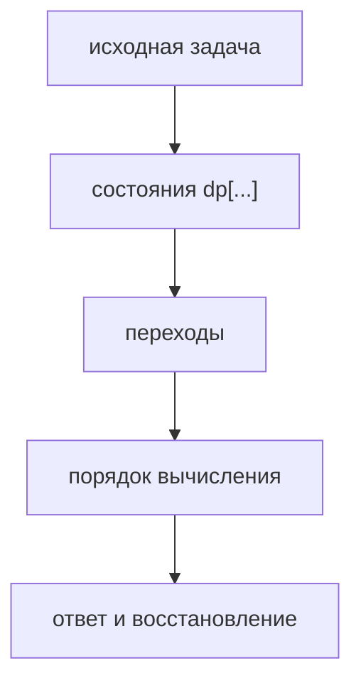
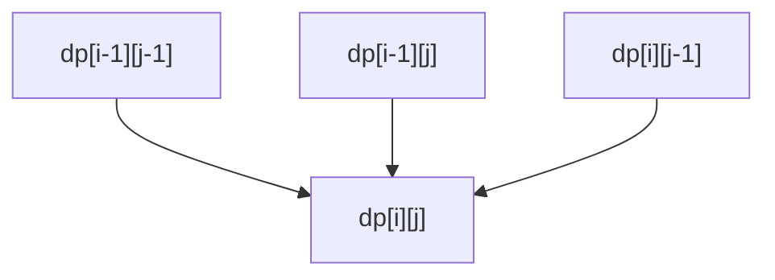
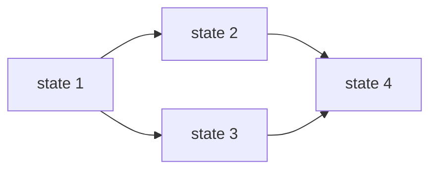

# Глава 10. Динамическое программирование

## 10.1 Идея динамики

Динамическое программирование применимо, когда:

1. задача разбивается на повторяющиеся подзадачи;
2. ответ подзадачи можно использовать в больших задачах;
3. порядок вычисления можно организовать так, чтобы все зависимости уже были посчитаны.

Состояние динамики — это краткое описание подзадачи.



## 10.2 Рецепт решения

1. Определи, что хранит `dp`.
2. Запиши базовые случаи.
3. Запиши переход.
4. Выбери порядок обхода.
5. Оцени сложность по числу состояний и стоимости перехода.
6. Если нужен сам объект, храни `parent` для восстановления.

## 10.3 Рюкзак 0/1

Есть предметы с весом `w[i]` и ценностью `cost[i]`. Вместимость `W`. Каждый предмет можно взять не более одного раза.

Состояние:

$$
dp[i][c] = \text{максимальная ценность, используя первые i предметов и вместимость c}
$$

Переход:

```text
dp[i][c] = dp[i-1][c]
if c >= w[i]:
    dp[i][c] = max(dp[i][c], dp[i-1][c-w[i]] + cost[i])
```

Сложность: `O(nW)`.

Оптимизация памяти:

```text
for each item i:
    for c = W downto w[i]:
        dp[c] = max(dp[c], dp[c-w[i]] + cost[i])
```

Идём справа налево, чтобы не взять один предмет несколько раз.

## 10.4 Наибольшая общая подпоследовательность

Даны строки `a` и `b`. Нужно найти длину LCS.

Состояние:

$$
dp[i][j] = LCS(a[0..i-1], b[0..j-1])
$$

Переход:

```text
if a[i-1] == b[j-1]:
    dp[i][j] = dp[i-1][j-1] + 1
else:
    dp[i][j] = max(dp[i-1][j], dp[i][j-1])
```



Сложность: `O(nm)`.

## 10.5 Динамика по отрезкам

Используется, когда состояние — отрезок `[l, r]`.

Пример: оптимальное перемножение матриц.

Пусть есть матрицы `A_l ... A_r`. Состояние:

$$
dp[l][r] = \text{минимальная стоимость перемножить } A_l \dots A_r
$$

Переход по последнему разбиению:

```text
dp[l][r] = min over k:
    dp[l][k] + dp[k+1][r] + cost(l, k, r)
```

Порядок вычисления — по длине отрезка:

```text
for len = 1..n:
    for l = 0..n-len:
        r = l + len - 1
        compute dp[l][r]
```

## 10.6 Динамика на графе состояний

Иногда переходы образуют DAG. Тогда динамика — это проход по топологическому порядку.



Если в графе есть циклы, обычная динамика не работает напрямую: нужны кратчайшие пути, итерационные методы или другой выбор состояний.

## Типовые ошибки

- Выбрать состояние, в котором не хватает информации для перехода.
- Обновлять одномерный рюкзак слева направо и случайно разрешить брать предмет много раз.
- Забыть базовые случаи.
- Хранить только значение, когда по условию надо восстановить ответ.

