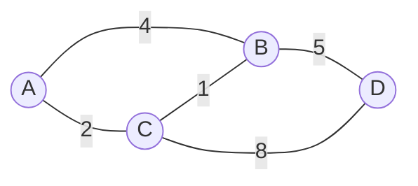
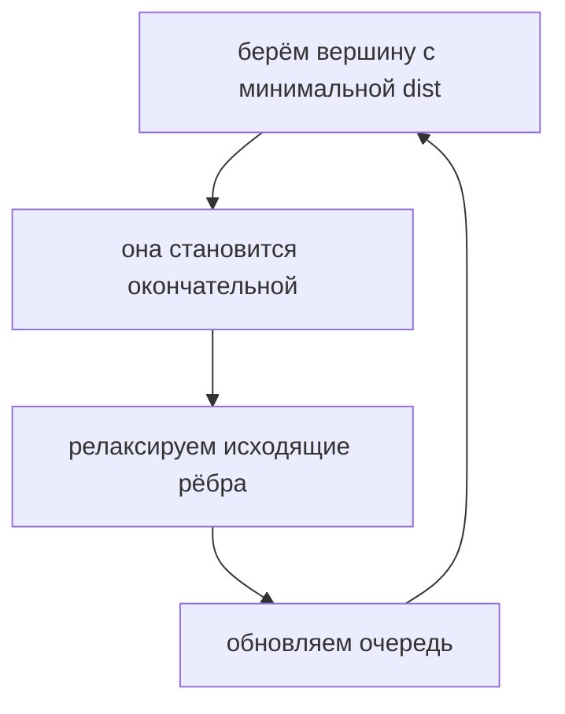

# Глава 11. Графы и кратчайшие пути

## 11.1 Основные определения

Граф состоит из вершин и рёбер.

| Тип | Что значит |
|---|---|
| Неориентированный | ребро работает в обе стороны |
| Ориентированный | ребро имеет направление |
| Взвешенный | у ребра есть стоимость |
| Невзвешенный | каждое ребро имеет стоимость 1 |



Граф обычно хранят списком смежности:

```text
g[v] = список пар (to, weight)
```

## 11.2 BFS

BFS находит кратчайшие пути в невзвешенном графе.

```text
bfs(start):
    dist[*] = INF
    dist[start] = 0
    queue.push(start)

    while queue not empty:
        v = queue.pop()
        for to in g[v]:
            if dist[to] == INF:
                dist[to] = dist[v] + 1
                parent[to] = v
                queue.push(to)
```

Сложность: `O(V + E)`.

## 11.3 Дейкстра

Дейкстра ищет кратчайшие пути от одной вершины при неотрицательных весах.

```text
dijkstra(s):
    dist[*] = INF
    dist[s] = 0
    pq.push((0, s))

    while pq not empty:
        (d, v) = pq.pop_min()
        if d != dist[v]:
            continue
        for (to, w) in g[v]:
            if dist[to] > dist[v] + w:
                dist[to] = dist[v] + w
                parent[to] = v
                pq.push((dist[to], to))
```



Сложность с бинарной кучей: `O((V + E) log V)`.

> [!warning]
> Дейкстра не работает с отрицательными рёбрами: вершина может быть объявлена окончательной слишком рано.

## 11.4 Беллман-Форд

Работает с отрицательными весами и умеет находить отрицательные циклы.

```text
bellman_ford(s):
    dist[*] = INF
    dist[s] = 0

    repeat V-1 times:
        for each edge (v, to, w):
            if dist[v] + w < dist[to]:
                dist[to] = dist[v] + w

    for each edge (v, to, w):
        if dist[v] + w < dist[to]:
            report negative cycle
```

Сложность: `O(VE)`.

## 11.5 Флойд-Уоршелл

Ищет кратчайшие пути между всеми парами вершин.

Состояние:

$$
d_k[i][j] = \text{кратчайший путь из i в j, использующий промежуточные вершины только из } 1..k
$$

Переход:

```text
for k = 0..V-1:
    for i = 0..V-1:
        for j = 0..V-1:
            d[i][j] = min(d[i][j], d[i][k] + d[k][j])
```

Сложность: `O(V^3)`, память `O(V^2)`.

## 11.6 Минимальное остовное дерево

Для связного неориентированного графа MST — набор рёбер, который соединяет все вершины и имеет минимальный суммарный вес.

### Краскал

```text
kruskal():
    sort edges by weight
    DSU init
    for edge (v, u, w):
        if find(v) != find(u):
            add edge to answer
            union(v, u)
```

Сложность: `O(E log E)`.

### Прим

Похож на Дейкстру, но ключ вершины — минимальный вес ребра, которым её можно присоединить к уже построенному дереву.

## Типовые ошибки

- Запускать Дейкстру при отрицательных весах.
- В BFS использовать стек вместо очереди.
- В Флойде не инициализировать `d[i][i] = 0`.
- В Краскале забыть DSU и получить цикл.

