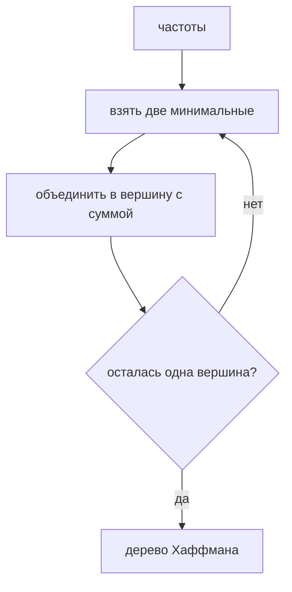

# Глава 12. Кодирование и сжатие

## 12.1 Префиксные коды

Префиксный код — код, в котором ни одно кодовое слово не является префиксом другого.

Это позволяет декодировать поток слева направо без разделителей.

```mermaid
graph TD
    R[""] -->|0| A["A"]
    R -->|1| X[""]
    X -->|0| B["B"]
    X -->|1| Y[""]
    Y -->|0| C["C"]
    Y -->|1| D["D"]
```

Коды:

| Символ | Код |
|---|---|
| A | 0 |
| B | 10 |
| C | 110 |
| D | 111 |

## 12.2 Задача Хаффмана

Даны частоты символов. Нужно построить префиксный код минимальной суммарной длины:

$$
\sum_c freq[c] \cdot len(code[c])
$$

## 12.3 Алгоритм Хаффмана

Идея: два самых редких символа должны оказаться глубже всех и быть братьями.

```text
huffman(freq):
    pq = min-heap of leaves by frequency
    while pq.size > 1:
        a = pq.pop_min()
        b = pq.pop_min()
        parent = Node(freq = a.freq + b.freq, left = a, right = b)
        pq.push(parent)
    return pq.pop_min()
```



Сложность: `O(k log k)`, где `k` — число разных символов.

## 12.4 Почему алгоритм корректен

Доказательство строится на жадном выборе:

1. В оптимальном дереве два символа с минимальными частотами можно разместить на максимальной глубине.
2. Их можно сделать братьями: если они не братья, обмен листьев не ухудшит ответ.
3. После объединения этих двух символов в один с частотой `f1 + f2` задача уменьшается на один символ.

Значит жадный шаг сохраняет существование оптимального решения.

## 12.5 Канонический код Хаффмана

Само дерево передавать неудобно. Достаточно знать длины кодов.

Канонический код строится так:

1. сортируем символы по длине кода, затем по символу;
2. первому символу даём код из нулей нужной длины;
3. следующий код получаем увеличением предыдущего числа и сдвигом до нужной длины.

Плюсы:

- компактное хранение таблицы;
- быстрый декодер;
- одинаковые длины кодов дают однозначные коды.

## 12.6 Связь с деревьями

Префиксный код всегда можно представить бинарным деревом:

- левое ребро — `0`;
- правое ребро — `1`;
- символы лежат в листьях;
- префиксность означает, что символ не может лежать во внутренней вершине.

## Типовые ошибки

- Назначать код внутренним вершинам дерева.
- Забыть случай одного символа: ему обычно дают код `0`.
- Путать частоту и вероятность: для оптимизации достаточно относительных частот.

