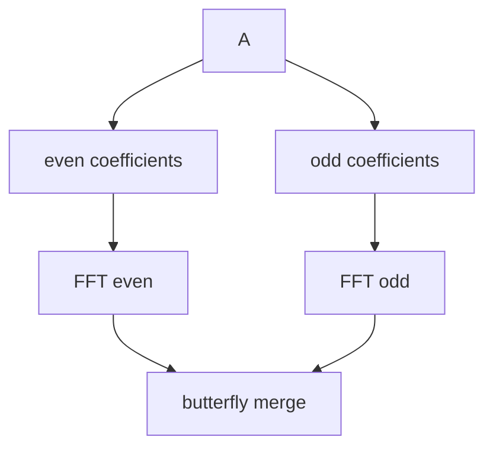

# Глава 13. Полиномы и быстрое преобразование Фурье

## 13.1 Умножение полиномов

Пусть:

$$
A(x)=a_0+a_1x+\dots+a_{n-1}x^{n-1}
$$

$$
B(x)=b_0+b_1x+\dots+b_{m-1}x^{m-1}
$$

Их произведение:

$$
C(x)=A(x)B(x)
$$

Коэффициенты:

$$
c_k = \sum_{i+j=k} a_i b_j
$$

Наивный алгоритм:

```text
for i = 0..n-1:
    for j = 0..m-1:
        c[i+j] += a[i] * b[j]
```

Сложность: `O(nm)`.

## 13.2 Представление по значениям

Полином степени меньше `n` однозначно задаётся `n` точками.

Чтобы умножить полиномы:

1. вычислить значения `A` и `B` в достаточном числе точек;
2. перемножить значения поточечно;
3. восстановить коэффициенты `C`.


FFT ускоряет шаги вычисления и интерполяции до `O(n log n)`.

## 13.3 Корни из единицы

Комплексное число $\omega_n$ — первообразный корень степени `n`, если:

$$
\omega_n^n = 1
$$

и степени $\omega_n^0, \omega_n^1, ..., \omega_n^{n-1}$ различны.

Обычно:

$$
\omega_n = e^{2\pi i/n}
$$

## 13.4 Разделение на чётные и нечётные коэффициенты

Разложим полином:

$$
A(x) = A_0(x^2) + xA_1(x^2)
$$

где:

- `A0` содержит коэффициенты с чётными индексами;
- `A1` содержит коэффициенты с нечётными индексами.

Тогда:

$$
A(\omega^k) = A_0(\omega^{2k}) + \omega^k A_1(\omega^{2k})
$$

Для второй половины:

$$
A(\omega^{k+n/2}) = A_0(\omega^{2k}) - \omega^k A_1(\omega^{2k})
$$

Это и даёт рекурсию FFT.



## 13.5 Псевдокод FFT

```text
fft(a, invert):
    n = len(a)
    if n == 1:
        return a

    a0 = a[0], a[2], a[4], ...
    a1 = a[1], a[3], a[5], ...

    y0 = fft(a0, invert)
    y1 = fft(a1, invert)

    angle = 2*pi/n
    if invert:
        angle = -angle
    w = 1
    wn = cos(angle) + i sin(angle)

    for k = 0..n/2-1:
        u = y0[k]
        v = w * y1[k]
        y[k] = u + v
        y[k+n/2] = u - v
        w *= wn

    if invert:
        divide all y by 2
    return y
```

При обратном FFT итоговые значения делятся на `n`. Если делить на `2` на каждом уровне рекурсии, суммарно получится то же самое.

## 13.6 Умножение через FFT

```text
multiply(a, b):
    n = 1
    while n < len(a) + len(b) - 1:
        n *= 2

    pad a and b to length n
    fa = fft(a, false)
    fb = fft(b, false)

    for i = 0..n-1:
        fc[i] = fa[i] * fb[i]

    c = fft(fc, true)
    round real parts of c
    return first len(a)+len(b)-1 coefficients
```

Сложность: `O(n log n)`.

## Типовые ошибки

- Взять `n` меньше, чем `len(a)+len(b)-1`, и получить циклическую свёртку.
- Забыть нормировку после обратного FFT.
- Не округлить вещественные ошибки после вычислений.
- Использовать FFT по комплексным числам там, где из-за модуля нужна NTT.

